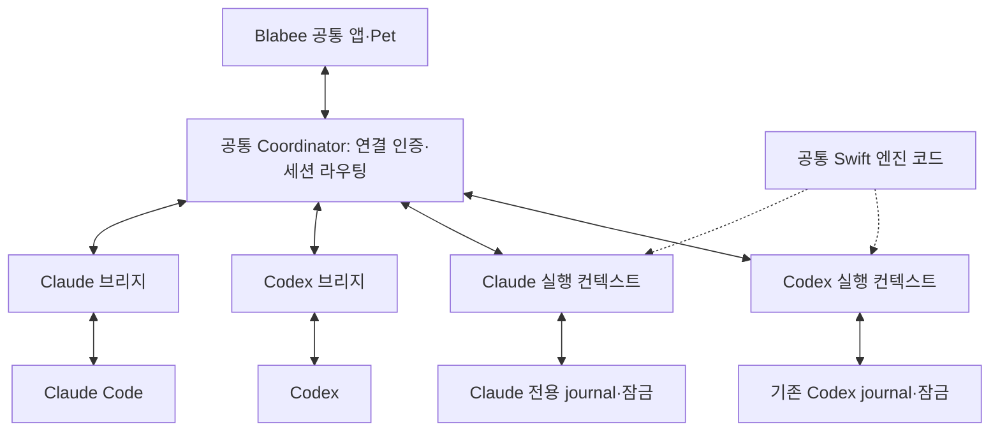

# Blabee 공통 엔진과 Codex·Claude 브리지 전환안

작성일: 2026-09-12. 최신 제품 설계: 2026-09-19. 현재는 공통 Swift 연결 계층·실제 Hook/MCP·격리된 공통 Pet의 모델 A 왕복을 확인했으며, **설치 앱의 다중 세션·장시간 수명·배포 연결은 미구현**이다. 아래 날짜별 초기 기록은 당시 범위를 보존한다.

2026-09-19 [제품 연결 설계](product-connection/TECH_SPEC.md)가 이 문서의 제품 등록·권한 갱신·durable metadata·시작/복구·payload 정책을 구체화한다. [CP-01~08](product-connection/IMPLEMENTATION_PLAN.md)은 현재 코드에서 진행할 구현 순서이며 기존 S 단계 전체를 완료했다는 뜻이 아니다. 이번 변경은 문서뿐이다. 고정 v1·기존 Codex 동작·단일 엔진/UI 원칙은 계속 유지한다.

최신 선택 작업에서는 사용자가 공통 본체의 접속 경로 연결을 승인했다. [제품 ingress 규격](PRODUCT_INGRESS.md)에 따라 단일 Swift 어댑터 target과 세션·역할별 capability 인증을 추가했다. 아래 초기 단계의 미착수·`claude/` 한정·본체 변경 보류 서술은 당시 준비 범위이며 이번 선택 작업의 권한을 제한하지 않는다. 실제 native 출처·durable mapping·readiness·Pet·패키징의 미완료 범위는 그대로 남는다. 최신 실행 결과는 [QA](../../../dev/claude-standalone/docs/QA_REPORT.md)를 따른다.

2026-09-18 후속 통합: 사용자가 다른 세션의 본체 작업 완료와 현재 코드 기준의 통합을 확인했다. 현재 본체·고정 계약 246개 파일의 기준 사본과 해시를 보존하고, `claude/shared-engine/`에서 기존 `CoordinatorSwift`를 직접 참조하는 연결 계층과 통합 fixture를 추가한다. 범위와 검증 결과는 [첫 통합 계층](SHARED_ENGINE_INTEGRATION.md)과 [QA 기록](../../../dev/claude-standalone/docs/QA_REPORT.md)을 따른다. 아래 초기 준비 단계의 S-00 미확보·통합 미착수 서술은 당시 상태다. 전체 제품 기준점·공통 ingress·인증·Pet·패키징과 full S-01의 미결정 항목은 이 부분 검증으로 완료되지 않는다.

2026-09-18 진행: `claude/`의 개발용 IPC·MCP·Pet과 현재 동작 테스트를 근거로 연결 규칙과 실패 검증표를 준비했다. **목표 공통 계약은 이 문서**, 현재 개발용 Claude IPC는 [IMPLEMENTATION_PLAN.md](../../../dev/claude-standalone/docs/IMPLEMENTATION_PLAN.md), 실행 증거는 [QA_REPORT.md](../../../dev/claude-standalone/docs/QA_REPORT.md)를 기준으로 한다. 개발 앱의 실제 A 선택 → claim → 파일 변경 → completion 성공은 공통 엔진 통합 증거가 아니다. S-00의 재현 가능한 기준점·파일 소유권 합의가 없으며, durable 매핑과 통합 fixture가 남아 있어 full S-01도 미완료다.

2026-09-12의 사용자 요청은 다른 세션의 Codex용 개발을 유지하면서 전환 방법을 구상하고 문서의 오류를 점검하는 것이었다. 당시 작업은 문서 작성·보완과 읽기 전용 조사로 한정했다. 후속 bridge 개발도 이 문서의 설계만을 근거로 기존 앱·설정·저장소를 교체하지 않는다.

## 1. 권장 결정

**Blabee 제품과 엔진 구현은 하나로 관리하고, Codex·Claude의 연결 방식은 각각의 브리지에서 처리한다.** 기존 Swift 엔진과 Pet을 기반으로 삼는다. Claude 쪽에서 만든 Hook·MCP 연결과 테스트를 재사용한다.

제품 결정은 한 앱·한 화면과 첫 Claude 사용 흐름이다. 아래 엔진·프로세스·저장·계약·폴더 구성은 그 결정을 구현하기 위한 기술 제안이다.

| 결정 | 제안과 이유 |
| --- | --- |
| 본체 | 기존 Swift `CoordinatorSwift`를 공통 엔진 기반으로 유지한다. 영속 기록·검증·라우팅을 Node로 다시 구현하지 않는다. |
| 앱 | 기존 `Blabee.app`과 제품 식별자를 유지하는 방향을 우선 검증한다. 공통 Pet에서 도구·프로젝트·세션을 구분한다. |
| 프로세스 | 공통 Coordinator의 소유자는 하나다. Pet 앱·서비스 자식·각 도구가 실행하는 브리지 프로세스는 따로 존재할 수 있다. OS 프로세스를 총 하나로 만드는 목표는 아니다. |
| 엔진 상태 | 같은 Swift 코드를 사용하는 도구별 실행 컨텍스트를 둔다. 초기 전환에서는 Codex·Claude의 journal·인증·잠금을 구분한다. |
| 저장 계약 | 기존 `Contracts/v1`과 DB를 무조건 바꾸지 않는다. 새 브리지 계약은 별도 버전으로 추가한다. |
| 폴더 | 초기에는 기존 파일 경로를 유지한다. 동작 분리와 검증 이후에 필요한 파일만 이동한다. |
| 첫 Claude 범위 | 새 세션에서 제안 → 사용자 선택 → 실행 → 결과 표시를 우선한다. 승인 중계와 기존 세션 연결·고급 복구는 후속 범위다. |

같은 버전의 공통 엔진을 양쪽 컨텍스트가 사용하므로 중복 클릭 방지나 선택 검증을 한 번 수정하면 양쪽에 적용된다. 도구별 버그 수정은 해당 브리지에 한정할 수 있다. 대신 공통 엔진 오류가 양쪽에 영향을 줄 수 있으므로 두 도구의 회귀 검증을 같은 배포 조건에 포함한다.

## 2. 현재 소스에서 확인한 출발점

2026-09-12 조사 당시 repository는 `/Users/joo/BiaDone`, branch는 `feat/common-lineage-v01-verifier`, HEAD는 `f0b4144b6315133585feaa81eb5ae4c3f11394e3`였다. 다른 세션의 미커밋 변경이 포함된 working tree를 읽었으므로 이 HEAD만으로 조사한 상태를 재현할 수 없다. 다음 source map은 읽기 전용 참고이며 S-00 기준점이 아니다. 줄 번호는 변경될 수 있으므로 심볼을 함께 확인한다.

- [Package.swift](../../../Package.swift)는 이미 `CoordinatorSwift` 라이브러리, `BlabeeCoordinator` 실행 파일, `BlabeeProductSupport`를 구분한다. 새로운 엔진을 처음부터 만들 필요가 없다.
- [CoordinatorBinding.swift](../../../engine/routing/CoordinatorBinding.swift)의 기존 session key에는 provider가 없고, v1 binding은 프로젝트·세션·턴·프롬프트·episode·boundary를 묶는다.
- [ContractPin.swift](../../../engine/validation/ContractPin.swift):4–43은 v1의 JSON 파일 목록과 해시를 고정한다. 같은 디렉터리에 새 JSON을 추가하거나 기존 필드에 `provider`를 삽입하면 호환성 검증이 깨진다.
- [SQLiteJournal.swift](../../../engine/persistence/SQLiteJournal.swift):47, 770–860은 schema version과 실제 schema object를 검증한다. provider 필드나 테이블을 임의로 더하는 작업은 별도 저장 형식 변경이다.
- [OperationalCLI.swift](../../../bridges/codex/swift/hooks/OperationalCLI.swift)의 `HookThreadRoutingPolicy.routedPayload`는 `agent_id`를 effective `session_id`로 사용한다. native turn과 내부 prompt·episode·boundary도 별도이므로 native session ID 하나로 공통 identity를 대체하지 않는다.
- [UnixDomainSocketTransport.swift](../../../app/service/UnixDomainSocketTransport.swift)의 `CoordinatorOperationalHandling`은 transport 앞에 라우터를 추가할 후보 경계다. 기존 프로토콜이 그대로 보존되는지 후속 검증이 필요하다.
- [main.swift](../../../app/entrypoints/main.swift):828 부근은 authority → journal → routing → operational → Codex dispatcher를 조립한다. 먼저 이 조립을 기존 Codex 컨텍스트 하나로 감싸는 작은 변경부터 할 수 있다.
- [HookPermissionPolicy.swift](../../../bridges/codex/swift/core/HookPermissionPolicy.swift):35에는 Codex qualification 정보가 있다. 라이브러리 target으로 나뉘어 있다는 사실만으로 전체 라이브러리가 이미 provider 중립적이라고 판단하지 않는다.
- [claude bridge](../../../dev/claude-standalone/src/bridge/mcp.mjs)는 Hook·SDK stdio·도구 검증과 IPC 호출 경계가 나뉘어 있다. 반면 [identity.mjs](../../../dev/claude-standalone/src/shared/identity.mjs):4–23은 독립 Claude 제품과 runtime에 고정되어 있어 공통 endpoint 연결로 바꿔야 한다.

그래프 `list_projects`, `search_graph`, `check_index_coverage`가 모두 `Transport closed`로 실패했다. 프로젝트 후보는 `Users-joo-BiaDone`이고 generation은 확인하지 못했다. 관련 소스·계약·테스트를 직접 읽은 범위의 설계이며 전체 코드 의존성을 검증한 결과는 아니다.

2026-09-18 준비에서 추가로 구분한 현재 경계는 다음과 같다. 세부 보존 조건은 §4–5와 §11에 연결한다.

| 현재 소스 | 보존하거나 해소할 차이 |
| --- | --- |
| [Claude launcher](../../../dev/claude-standalone/scripts/blabee-claude.mjs), [Hook](../../../dev/claude-standalone/src/bridge/hook.mjs) | launcher가 UUID session을 만들고 `--session-id` 일치만 지원하며 subagent를 거절한다. Hook은 전체 prompt의 SHA256을 전달한다. |
| [Claude service](../../../dev/claude-standalone/src/coordinator/service.mjs)의 `bridge.open`, `selectionContinuationForm` | 논리 bridge에 별도 UUID를 발급하고 model 요청의 session token·현재 bridge ID를 검증한다. 이 UUID들은 목표 durable registry 구현이 아니다. 정확한 delivered 선택 메시지의 continuation 지원 범위는 §4에 한정한다. |
| 같은 service의 poll·claim·completion | poll이 durable `delivered`를 먼저 기록하고 이후 bridge가 notify한다. claim은 token을 소모하고 내부 boundary를 새로 만든다. C-L01은 미보고 claim을 별도 보관하고, 새 입력 뒤 결과를 원래 작업 audit에 기록하며 최신 카드·작업은 바꾸지 않는다. |
| [Swift semantic](../../../engine/semantic/CoordinatorSemanticApplication.swift)의 `claimQueuedActionContext`, `recordWorkOutcome`; [operational](../../../app/coordination/CoordinatorOperationalApplication.swift)의 queue receipt | 기존 Codex의 멱등 claim·durable 복구를 보존한다. closed boundary를 요구하는 queued claim과 open boundary만 받는 outcome 사이에 Claude 결과 audit 계약을 먼저 정해야 한다. |


## 3. 목표 구조



`실행 컨텍스트`는 엔진 구현의 복사본이 아니라 같은 코드에 주입하는 상태 묶음이다. journal, routing state, delivery adapter, secret corpus, 연결 세대를 함께 묶는다. 외부 입력이 임의의 컨텍스트를 선택하지 못하도록 본체가 인증된 연결에 컨텍스트를 부여한다.

| 책임 | 위치 |
| --- | --- |
| 제안·선택 검증, 최신 boundary, 중복 claim 방지, 감사 기록 | 공통 엔진 |
| 도구·세션 등록, 연결 인증, 컨텍스트 라우팅, 공통 UI snapshot | 공통 Coordinator의 운영 계층 |
| Hook 해석, native/effective session 정규화, 작업 전달, 도구 승인 규격 | 각 브리지 |
| 선택지·프로젝트·도구·세션 표시, 준비 상태와 실패 설명 | 공통 Pet |
| 앱 실행·업데이트·설치 identity와 runtime 사용 잠금 | 공통 제품·패키징 계층 |

MCP가 모든 경계의 공통 계약일 필요는 없다. Claude 쪽 stdio MCP는 Claude 브리지 내부에 유지하고, 브리지와 본체 사이에 Blabee의 버전 있는 IPC 계약을 둔다. 본체는 각 도구의 MCP·Hook 출력 형식을 직접 해석하지 않는다.

## 4. 공통 브리지 계약 초안

아래 operation·필드 이름은 **미구현 draft**다. 기존 Codex wire contract를 즉시 바꾸지 않고 compatibility adapter로 기존 진입점을 보존한다. 새 계약 파일은 예를 들어 `Contracts/bridge/v1/`에 두며 고정된 `Contracts/v1/`과 분리한다. 이 준비 단계에서는 새 schema나 production source를 만들지 않는다.

### 연결과 식별자

1. `bridge.hello`: bridge 계약 버전 범위, provider, bridge/runtime 버전과 지원 기능을 제시한다.
2. 본체는 지원 버전과 신뢰한 등록 주체를 확인하고 `bridge_instance_id`·연결 세대·권한 범위를 발급한다. 모델 문자열이나 raw IPC의 `provider`, scope, 경로만으로 실행 컨텍스트를 선택할 수 없다.
3. `session.open`: 본체의 `core_session_id`와 native/effective session·agent 관계를 등록한다. provider가 정의하는 native ID 형식과 내부 ID를 구분하고 실제 session 수명을 나타내는 `session_incarnation`을 부여한다.
4. 이후 모든 명령은 인증된 연결·컨텍스트·session·연결 세대에 묶인다. UI 선택에는 대상 session incarnation·task boundary와 현재 화면 세대도 포함한다.

업무 식별자는 `(runtime_scope, core_session_id, session_incarnation)`이고 native identity에는 provider·native session·effective thread/agent 정보를 별도로 보존한다. **다른 provider가 같은 native session/agent ID를 사용하는 것은 허용한다.** 다른 컨텍스트의 인증으로 그 session을 조회·선택·claim하려는 요청을 거부한다. 프로젝트는 표시 문자열뿐 아니라 검증된 작업 디렉터리에 연결한다. Codex의 기존 ID·subagent 전달 의미는 adapter가 보존한다.

| 식별자·세대 | 발급·검증 주체 | 교체·폐기와 권한 |
| --- | --- | --- |
| `runtime_scope` | 제품이 정한 registry가 인증된 provider 등록에 결합 | 연결이 요청한 문자열로 변경하지 않음. scope 폐기 시 해당 권한 폐기; 다른 scope에 승계 없음 |
| `core_session_id` | 본체가 native/effective 관계를 검증해 발급·조회 | 같은 session의 재접속에서는 검증된 매핑 유지. ID 자체는 인증 수단이 아님 |
| `session_incarnation` | 본체가 provider의 실제 session 수명·분기 증거에 따라 발급 | 검증된 새 session/분기는 새 incarnation. 이전 선택·실행 권한 승계 없음; Stop·socket 교체만으로 새로 발급하지 않음 |
| native session / effective agent | native 값을 bridge가 관측·정규화하고 등록 binding과 대조 | native 값과 effective 값을 함께 보존. Codex `agent_id` routing 유지, 현재 Claude subagent 미지원. 동명 ID는 scope로 구별 |
| native prompt / turn | provider가 발급한 값을 bridge가 관측 | 없으면 nullable/unknown. 내부 UUID를 native 값으로 발명하지 않음; prompt만으로 origin·claim 권한 증명 불가 |
| `bridge_instance_id` / `connection_epoch` | 본체가 논리 bridge 등록·교체 때 발급 | 옛 등록의 쓰기 권한·readiness 폐기. 같은 session의 incarnation이나 원래 claim 감사 기록을 지우지 않음 |
| task boundary | 본체가 수용한 입력·continuation 규칙으로 발급 | 새 사용자/불명 입력은 옛 미claim 선택 무효화. claim 이후는 superseded로 구별하며 실행 중단으로 단정하지 않음 |
| UI generation | 본체의 버전 있는 snapshot이 발급하고 Pet이 선택에 반영 | 해당 scope/session/card 갱신 시 옛 선택 자격 폐기. 늦은 응답은 현재 카드에 적용하지 않음; 독립 실행 권한은 없음 |

`connection_epoch`는 논리적인 bridge 등록의 세대다. 현재 [Claude IPC client](../../../dev/claude-standalone/src/shared/client.mjs)는 요청마다 새 socket을 열므로 **요청별 UDS 재접속은 epoch를 바꾸지 않는다.** 실제 bridge 교체·논리 등록 복구만 새 epoch 대상이다. Hook의 단기 요청도 검증된 session 등록에 결합한다. heartbeat timeout은 readiness 유효성 문제이며 session incarnation 변경이나 작업 취소의 근거가 아니다. 인증된 durable 매핑의 저장·복구 형식은 §5의 미결정 사항으로 남긴다.

UI token을 모델 자식에게 전달하지 않는다. 기존 Codex의 caller 검증과 managed 승인 경계를 범용 session token만으로 대체하지 않는다. Claude bridge의 등록 주체·실행 경로·child binding을 어떤 증거로 확인할지는 S-03에서 구체화한다. 확인하지 못한 기능은 활성화하지 않는다.

### 제안 내용의 차이

현재 Swift 제안은 binding, `task_goal`, outcome의 status/summary, `reported_side_effects`와 action의 `objective`, `constraints[]`, `done_when[]`를 요구한다. Claude 개발 도구는 `summary`와 option의 `id`, `title`, `description`, `task`, 단일 문자열 `done_when`을 받는다. [Swift proposal 검증](../../../app/coordination/CoordinatorOperationalApplication.swift), [Claude tool schema](../../../dev/claude-standalone/src/bridge/tools.mjs).

따라서 IPC 주소 교체만으로 제안이 호환되지 않는다. Claude 도구가 필요한 보고·제약·완료 기준을 실제 입력으로 받도록 schema와 instructions를 맞춘다. bridge가 누락된 성공 상태·부작용 없음·제약을 임의로 채우지 않는다. 공통 schema가 불명확한 결과를 표현하지 못하면 변환을 거부하거나 명시적 계약 확장을 설계한다. 선택지의 identity·title·description·순서·작업 내용·완료 기준을 변환 과정에서 소실하지 않는다.

### 공통 operation의 증거 의미

모든 operation은 인증된 업무 식별자와 권한을 먼저 검증한다. 아래 단계는 서로의 성공 증거를 대신하지 않으며 저장된 증거의 수준을 함께 반환한다.

| operation 초안 | 필요한 binding과 기록 | 증명하지 않는 것 |
| --- | --- | --- |
| proposal | 현재 task와 완전한 입력 schema에 결합한 제안·revision | 사용자 선택, 실행 권한, 성공한 outcome |
| selection | UI 권한·generation·session incarnation·task·packet/revision·option을 검증한 durable 선택 | provider 수신, native permission, 실제 실행 |
| dispatch evidence | 동일 선택 ref에 전달 시도·로컬 기록·write·provider receipt를 각각 실제 근거대로 기록 | `delivered`나 notification write만으로 receipt/claim/실행으로 승격 불가 |
| claim | 현재 실행 주체·전달 binding·선택 내용을 검증한 원래 claim identity와 작업 반환 | 실제 파일 변경·성공. 동일 claim 재응답은 새 실행 권한이 아님 |
| result audit | 현재 유효한 작성 권한과 원래 claim을 검증한 status·summary·보고된 산출물/검증 근거 | 모델 완료 보고만으로 검증된 성공, 최신 카드 완료, 옛 실행 권한 복원 |

readiness probe/ACK는 선택과 별도 operation이며 준비 증거만 만든다. token 단독이나 모델이 다시 쓴 task 문자열로 저장된 선택 binding을 대체하지 않는다.

### 기능 협상

| 기능 | 기록할 내용 |
| --- | --- |
| proposal | 지원 제안 schema, 선택지 수·내용·증거 제약 |
| lifecycle | 관측 가능한 이벤트, native prompt ID 유무, 시작 원인 |
| continuation | Codex queue 또는 Claude Channel 등 전달 방식, 실제 준비 증거 |
| claim | 선택을 한 번 가져오는 기능과 binding 방식 |
| completion | 모델 보고·테스트 결과 등 증거 수준 |
| permissions | native 승인 유지 또는 별도로 검증된 relay 범위 |
| session modes | new/resume/attach/fork 지원 여부 |

계약 major가 맞지 않으면 연결을 거부한다. minor 기능은 양쪽이 명시적으로 지원하는 교집합만 사용한다. 브리지 계약 버전, provider CLI 버전, MCP protocol revision은 별도 값이다. 알 수 없는 기능을 지원한다고 추정하지 않는다.

### 선택 기능과 독립적인 최초 연결 확인

`continuation ready`를 실제 선택 왕복으로만 확인하면, 선택을 열기 위해 선택부터 해야 하는 순환이 생긴다. S-01에 **작업 선택과 분리된 준비 확인 probe**를 정의한다.

- 본체는 session incarnation·논리 connection epoch·기한에 묶인 일회용 nonce를 만들고, 사용자가 연결 확인을 시작한 세션의 Claude Channel로 보낸다.
- Claude는 작업이나 파일 변경 없이 전용 `ack_readiness_probe` 도구로 받은 nonce만 반환한다. 도구는 현재 등록·nonce·기한을 검증하고 준비 증거만 기록한다. proposal·selection·claim을 만들거나 실제 작업을 승인하지 않는다.
- 단순 MCP 초기화, 도구 목록 조회, notification 쓰기, bridge의 자체 echo는 수신 확인으로 인정하지 않는다. 확인 도구에 대한 Claude의 원래 승인 절차가 있다면 그대로 거친다.
- 이 결과는 해당 세션에서 한 번 관측한 전달 증거다. 이후 메시지의 수신이나 native caller의 암호학적 신원을 보장하지 않으며, bridge 신뢰 검증을 대신하지 않는다. 실제 선택에는 매번 현재 binding·claim 검증을 적용한다.
- timeout·오류·다른 세션/epoch의 응답은 준비 미확인으로 남긴다. 논리 bridge 교체·설정 변경 시 과거 증거를 폐기하고 다시 확인한다. nonce 만료 뒤 도착한 응답이 선택 기능을 뒤늦게 켜지 않도록 한다.

2026-09-18 Claude 개발 bridge에는 `check_connection`·`ack_readiness_probe`와 session/논리 bridge 등록에 묶인 probe를 추가했다. 별도 Node 검증용 서비스의 구현이며, 공통 본체의 session incarnation·durable 매핑·신뢰 검증까지 구현한 것은 아니다. 자동 검증과 실제 Claude 모델의 수신 확인은 [QA_REPORT.md](../../../dev/claude-standalone/docs/QA_REPORT.md)에서 구분한다.

### 작업 수명 주기

공통 관측에는 `origin=user|selection|provider_system|unknown`, 시작 원인, nullable native prompt/turn ID, 본체가 발급한 내부 boundary를 구분한다. origin은 제안된 분류이지 모든 provider가 제공하는 필드가 아니다. native ID가 없을 때 내부 UUID를 native ID인 것처럼 채우지 않는다. `selection` 근거는 검증된 전달 ref·claim 결합이며, `prompt_id`나 최근 선택의 존재만으로 native Hook의 출처를 판정하지 않는다.

현재 Claude 개발 bridge는 선택 continuation을 제한적으로 구현했다. `hook.mjs`는 **전체 prompt 문자열의 SHA256**만 전달한다. `selectionContinuationForm`은 현재 **delivered** 선택의 session·bridge·packet·revision·boundary·token과 전체 body 또는 canonical wrapper의 digest가 모두 맞을 때 새 native prompt ID를 기록하고 기존 선택 boundary를 보존한다. 같은 prompt ID·같은 form의 **claim 전** 재요청만 멱등이다. 다른 `user_or_unknown` 입력은 무효화한다. 이는 공개 native origin 인증이 아니며, 다른 포맷·배치된 notification·그 밖의 기존 prompt ID 재사용·claim 후 Hook까지 지원한다는 뜻이 아니다.

S-01/S-04는 `Channel 후 Hook 없음 → claim`, `정확한 메시지의 새 prompt ID`, `동일 preclaim retry`, `다른 ID로 replay`, `실제 사용자 입력과 경합`을 별도 fixture로 다룬다. readiness Channel이 Hook을 유발하는 경우도 선택 continuation 예외를 그대로 재사용하지 않는다(C-L03). 출처를 식별할 근거가 없으면 `unknown`과 새 입력 무효화 규칙을 유지하며, 안전하게 연결할 수 없는 조합의 자동 후속 실행은 미지원으로 둔다.

| 상태·관측 | 의미와 처리 |
| --- | --- |
| bridge connected | IPC/MCP 프로세스가 연결됨 |
| continuation ready | 해당 세션의 반환 경로가 별도로 확인됨. 연결만으로 추정하지 않음 |
| response stopped | 응답 종료 관측. 성공·완료로 변환하지 않음 |
| selection recorded | 사용자의 선택이 최신 패킷에 대해 기록됨 |
| dispatch attempted / provider accepted | 전달 시도 또는 실제 provider 접수 증거. 로컬 `delivered`와 구분 |
| selection claimed | 같은 세션이 저장된 작업을 한 번 가져옴 |
| completion reported | 모델 등의 결과 보고. 검증된 실행 성공과 구분 |
| invalidated | 아직 claim하지 않은 선택이 새 task boundary·session 종료·권한 폐기로 실행 자격을 잃음 |
| superseded / cancellation requested | claim 이후 새로운 입력·중단 요청이 발생함. 이미 시작한 native 작업이 멈췄다는 뜻은 아님 |
| uncertain / disconnected | 전달 결과나 연결 상태가 불명확함. 이것만으로 durable claim을 폐기하거나 작업 성공·실패를 확정하지 않음 |

본체의 기존 `queued_next_turn` 접수·claim 규칙과 Claude Channel notification을 같은 receipt로 취급하지 않는다. provider별 전달 adapter가 증거를 보고하고 공통 운영 계층이 그 의미에 맞게 상태를 갱신한다. 전달 결과가 불명확하면 자동 재전송하지 않는다. 재시도 기능을 만들 경우 별도 idempotency·중복 실행 검증이 필요하다.

현재 Claude poll은 journal에 `delivered`를 저장한 다음 bridge에 응답하고, bridge가 notification을 쓴다. 따라서 poll 응답 유실이나 notify 실패에도 기록은 남을 수 있으며 자동 replay는 없다. `delivered`는 provider receipt·claim·실행 증거가 아니다. 독립 nonce ACK로 얻은 readiness도 개별 선택의 수신 보증이 아니다.

작업 재전송과 claim 결과의 재조회도 구분한다. 현재 Swift `claimQueuedActionContext`는 **closed boundary·completed transport·실제 delivery turn/prompt·cwd·action digest**를 요구한다. 동일 delivery turn·digest의 반복 요청은 새 이벤트 없이 기존 결과를 반환하고 다른 binding의 재소비는 거부한다. 현재 Claude는 claim token을 소모하고 내부 boundary를 새로 만들며 두 번째 claim을 거절한다. 이 차이를 공통 규칙으로 굳히지 않는다. 기존 Codex의 멱등 응답·복구를 보존하고 같은 claim 재응답을 새 실행 권한으로 해석하지 않는다. [Swift claim 처리](../../../engine/semantic/CoordinatorSemanticApplication.swift):927, 957; [Claude claim 처리](../../../dev/claude-standalone/src/coordinator/service.mjs).

claim 이후에는 원래 claim·작업 내용·실행 상태를 최신 카드와 별도로 유지한다. `claim → 파일 수정 → 새 사용자 입력 → 결과 보고`에서도 현재 유효한 작성 권한과 원래 claim을 검증해 **과거 작업의 결과 보고를 감사 기록으로 남길 수 있어야 한다.** 이 보고가 새 카드나 새 작업을 완료로 바꾸거나 옛 실행 권한을 되살려서는 안 된다. 취소 요청과 실제 중단 확인은 구분하고, 중단 증거가 없으면 실행 종료를 추정하지 않는다. session 종료로 인증이 폐기되거나 결과를 회수할 수 없다면 미확인 상태를 보존한다.

C-L01은 이 규칙을 개발용 Node Coordinator에 적용한다. 세션별 미보고 claim을 최대 32개 보관하고, 새 입력은 이미 claimed 작업을 최신 화면에서 분리한다. 현재 session·bridge 권한으로 원래 claim의 결과를 한 번 기록하되, 옛 bridge·다른 session·미claim 선택·중복 보고는 거절한다. claim/result 이벤트는 원래 cwd·선택·작업·완료 기준·native prompt·boundary를 함께 기록하고 token은 포함하지 않는다. 현재 작업의 완료 UI는 유지하며 과거 결과 목록 UI와 재시작 후 보고 권한 복구는 추가하지 않는다. 이것은 공통 Swift의 durable 매핑·결과 계약 구현과 구분한다.

**통합 blocker: Claude 결과 audit의 수용 경로를 결정해야 한다.** 현재 [operational queue receipt](../../../app/coordination/CoordinatorOperationalApplication.swift):3615는 `completeTransportAndCloseBoundary`를 호출하며 queued claim은 그 closed boundary를 요구한다. 반면 [semantic `recordWorkOutcome`](../../../engine/semantic/CoordinatorSemanticApplication.swift):1036은 open boundary만 받는다. Claude의 `complete_selection`을 claim 뒤 기존 `record_work_outcome`에 단순 매핑하면 `decision_boundary_closed`가 된다. 이는 기존 Codex 버그 판정이 아니라 provider별 continuation·결과 audit 계약의 미결정 사항이다. Claude claim 때 만든 내부 boundary도 새 native UserPromptSubmit의 증거가 아니다. S-01에서 무손실 표현 가능성을 결정하고, 불가능하면 별도 계약 버전·replay·호환 fixture를 설계한다. v1 해시만 바꾸거나 가짜 turn/receipt·성공 outcome으로 통과시키지 않는다.

SessionStart는 새 세션 생성과 같지 않다. source를 보존한 뒤 provider 의미에 따라 기존 수명 유지·새 incarnation·분기를 결정한다. 지원하지 않는 resume·fork·subagent 조합은 제한을 표시하고 실행 경로를 열지 않는다. 관측이 없거나 연결이 끊긴 상태를 completed/canceled로 변환하지 않는다.

### Claude 호환성에서 추가로 확인할 것

2026-09-18 공식 계약 확인과 현재 adapter의 차이는 다음과 같다. 수집·해석 보완은 C-L02의 후속 범위이며, 이 표를 현재 지원 선언으로 읽지 않는다.

| 관측 | 공식 의미와 목표 처리 | 현재 개발 adapter의 제한 |
| --- | --- | --- |
| [SessionStart](https://code.claude.com/docs/en/hooks#sessionstart-input) | `source=startup/resume/clear/compact/fork` 보존 | source를 버리므로 반복 SessionStart 테스트만으로 모든 원인을 구분했다고 볼 수 없음 |
| [UserPromptSubmit](https://code.claude.com/docs/en/hooks#userpromptsubmit-input) | prompt는 존재하지만 문서화된 native origin/channel 필드는 없음 | 전체 digest의 제한된 continuation 검증; native origin 인증 아님 |
| [Stop](https://code.claude.com/docs/en/hooks#stop) | 전경 응답 종료이며 사용자 interrupt에는 발생하지 않음. `background_tasks`/`session_crons`의 부재와 빈 배열도 구별 | background 필드를 전달하지 않음. Stop만으로 성공·claim 완료·background 종료를 표시할 수 없음 |
| [StopFailure](https://code.claude.com/docs/en/hooks#stopfailure) | API 실패 event/error와 optional details를 관측 근거로 보존 | 미지원. 실패 유형을 일반 Stop이나 성공으로 합치지 않음 |
| [SessionEnd](https://code.claude.com/docs/en/hooks#sessionend) | `reason=clear/resume/logout/prompt_input_exit/other`를 보존하고 실제 관측 시 수명 정리 | reason을 버림. 종료 Hook 전달 자체는 보장으로 추론하지 않음. 미수신·disconnect는 종료/취소 확인이 아님 |

- Channels 메시지는 busy 상태에서 모여 전달될 수 있다. notification 하나를 native 턴 하나로 간주하지 않는다. [공식 notification 규약](https://code.claude.com/docs/en/channels-reference#notification-format).
- 조직 정책상 Channels가 꺼져도 MCP 도구는 연결될 수 있다. 따라서 SDK initialized나 heartbeat만으로 Pet 선택을 활성화하면 안 된다. 조사 시점의 revision 제약은 **Claude v2 MCP client runtime에서 `MCP_PROTOCOL_NEGOTIATION=auto`로 해당 서버가 실제 `2026-07-28`을 협상한 경우**다. 모든 v2 runtime이나 최신 Claude가 불가하다는 뜻이 아니다. 배포마다 실제 revision·정책·왕복을 확인한다. [공식 Channels 정책·협상 제한](https://code.claude.com/docs/en/channels#enterprise-controls), [MCP의 Channels 조건](https://code.claude.com/docs/en/mcp#push-messages-with-channels).
- Claude의 권한 relay는 별도 지원 기능이다. 기존 Codex allow-once나 managed approval의 증거를 Claude 승인에 재사용하지 않는다. 초기 Claude 지원은 native 승인 흐름을 유지한다. [공식 permission relay 규약](https://code.claude.com/docs/en/channels-reference#relay-permission-prompts).

## 5. 저장소·잠금·재시작

첫 전환의 목표는 엔진 코드 공유다. 서로 다른 제품에서 만들었던 기록을 하나의 DB로 합치는 것은 별도 작업이다.

- 기존 Codex 저장 경로·DB identity·키·freshness anchor는 유지한다. 실제 설치 전환에서 같은 DB를 두 Coordinator가 동시에 소유하지 않도록 기존 서비스의 정상 소유권 인계를 검증한다.
- Claude에는 같은 journal 구현을 사용하는 새 컨텍스트를 부여한다. 기존 개발용 `claude/build/.../journal.json`을 SQLite나 기존 Codex DB에 자동 복사하지 않는다.
- [StorageProcessLock.swift](../../../engine/persistence/StorageProcessLock.swift):11–15는 키 파일의 부모 디렉터리에 잠금을 둔다. 파일 이름만 다르게 하는 것으로 충분하다고 가정하지 않는다.
- [KeychainFreshnessAnchorStore.swift](../../../engine/persistence/KeychainFreshnessAnchorStore.swift):6–25는 서비스 이름을 고정하고 account/storage slot을 받는다. 검증된 provider별 slot·경로를 제품 계층이 선택하도록 설계하되 기존 slot은 변경하지 않는다. 실제 Keychain 접근은 후속 설치 검증이다.
- 논리 bridge 교체·등록 복구 때 연결 token과 connection epoch를 갱신한다. 요청별 socket 재접속은 세대를 바꾸지 않는다. session incarnation과 durable task binding은 별도 규칙으로 유지·교체한다. 기존 Codex 복구 규칙은 보존하고, 새 Claude 경로는 과거 활성 선택을 임의로 재실행하지 않는다.
- 공통 endpoint·provider별 컨텍스트는 명시적인 연결 설정으로 선택한다. 기존 Claude 전용 endpoint에서 공통 endpoint로 조용히 fallback하거나, 요청자가 임의의 DB·socket 경로를 지정하게 하지 않는다.

컨텍스트 분리로 v1 변경을 줄일 수 있지만 이것만으로 모든 운영 가정이 해결되는 것은 아니다. timer·deadline·전역 foreground·서비스 authority·secret corpus가 컨텍스트별로 올바르게 묶이는지는 S-03의 검증 대상이다.

### 제품 저장소 구성의 선행조건

각 컨텍스트에 제품이 결정한 `ScopeStorageDescriptor`를 주입하는 안을 S-03에서 구현한다. 이 이름은 신규 설계이며 현재 API가 아니다. descriptor는 scope ID, 검증된 DB 경로, 별도 key 부모 디렉터리, 고정 freshness service의 account, DB authority identity를 함께 묶는다. 두 scope가 같은 DB·key 영역·account를 가리키는 중복 설정은 저장소를 열기 전에 거부한다.

현재 [main.swift](../../../app/entrypoints/main.swift)의 `FreshnessRuntimeConfiguration`은 제품 실행에서 `primary` account를 사용한다. 같은 생성자를 Claude에 그대로 두 번 적용하면 별도 DB가 기존 Codex anchor를 조회할 수 있다. 제품이 고른 scope descriptor로 이 조립을 확장하며 테스트 전용 환경변수를 제품 설정으로 전용하지 않는다. 각 scope의 `CoordinatorAuthorityLease`는 journal 초기화 전에 획득하고 컨텍스트 수명 내내 보유한다. 현재 authority가 DB 경로 해시별이라는 사실만으로 다른 잠금·account까지 자동 분리되지는 않는다.

### session 매핑과 durable claim 복구의 선행조건

현재 operational session dictionary는 메모리 상태이고, v1 binding에는 `core_session_id`·`session_incarnation`이라는 새 매핑 필드가 없다. 따라서 §4의 식별자를 추가하는 것만으로 재시작 복구가 성립하지 않는다.

- 기존 Codex v1에 저장된 session ID는 보존한다. 재시작 때 같은 native/effective session에 임의의 새 core ID를 발급해 기존 queued claim과 다른 ID로 전달하지 않는다.
- S-01에서 `(scope, native/effective identity, incarnation) ↔ durable v1 session ID`의 저장 위치·인증·복구 방식을 확정한다. **인증된 영속 매핑**을 쓰거나 **기존에 검증된 durable binding으로 무손실 재구성**할 수 있음을 증명해야 한다. 현재 이 방식 선택은 미결정이다.
- 새 영속 매핑이 필요하면 계약 버전, 쓰기 순서·원자성, crash 후 불일치 처리까지 명시한다. 인증 없는 보조 JSON이나 새 v1 필드로 임시 해결하지 않는다.
- 같은 native ID라는 이유만으로 이전 incarnation의 권한을 새 세션에 복구하지 않는다. 매핑을 확인할 수 없으면 해당 재개 요청을 미확인으로 남기고 이전 작업을 자동 전달하지 않는다.
- `queue 접수 직후 본체 재시작 → 같은 Codex 세션에서 원래 claim 복구`, `같은 claim 재응답`, `새 incarnation이 이전 claim 요청`, `매핑 유실·변조·부분 저장`을 각각 fixture로 검증한다. 지원한 기존 Codex 복구가 깨지면 S-03을 완료하지 않는다.

| 상황 | 연결·업무 상태 처리 |
| --- | --- |
| 요청별 UDS 재접속, 논리 등록이 유효함 | 인증과 현재 binding을 매번 검증하되 epoch·incarnation을 바꾸거나 선택을 다시 만들지 않음 |
| 논리 bridge 교체, 인증된 같은 session 매핑 확인 | 새 등록·epoch와 준비 확인이 필요. selected/delivered 선택은 무효화하고 원래 claimed 작업·감사 기록은 보존. 옛 등록의 쓰기 권한은 복구하지 않음 |
| heartbeat 손실·일시적 disconnect | readiness를 제거하고 재확인 전 선택을 열지 않음. 실제 실행 중단·완료나 session 종료로 단정하지 않음 |
| 공통 본체 재시작 시 Codex 컨텍스트 | 기존 durable queue·claim 복구 규칙을 유지. 새 연결 인증과 과거 task 유효성을 따로 검증 |
| 공통 본체 재시작 시 Claude 컨텍스트 또는 전달 결과 불명확 | 새 연결로 등록하되 이전 미확인 선택을 자동 재전송하지 않음. 완료 여부를 추정하지 않음 |
| 명시적 새 세션·clear/fork·native identity 변경 | provider 의미에 따라 새 incarnation 또는 분기 관계를 만들고 이전 token·선택 권한을 계승하지 않음 |
| Claude 컨텍스트에 한정된 journal 손상·키/slot 접근 실패·설정 오류 | 해당 컨텍스트만 비활성화하고 복구 안내. 정상 Codex 컨텍스트는 계속 시작·처리 |
| 공통 실행 파일·ingress의 무결성/기동 실패 또는 양쪽이 쓰는 시스템 Keychain 장애 | 공통 장애로 처리. 컨텍스트 구분으로 시스템 전체 장애까지 격리된다고 보장하지 않음 |

같은 session으로 재결합할 수 없으면 명시적인 진단 상태를 유지한다. 재연결을 이유로 기존 Codex의 유효한 queued claim을 삭제하거나, 반대로 이미 소비된 작업을 새로 허용해서는 안 된다.

현재 Claude 개발 runtime은 restart 시 **감사 이력만 복구하고 session token·선택·claim 결과 보고 권한을 버린다.** 이는 공통 Swift의 completed queue·claim 복구를 대체할 설계가 아니다. C-L01의 새 입력에 따른 `selection.superseded`나 session 종료에 따른 권한 폐기를 native 실행 취소 증거로 사용하지 않는다. 감사 이력 보관은 기존 개발용 journal의 제한된 범위를 따른다.

## 6. UI와 실제 동시 작업

공통 Pet은 카드마다 도구, 프로젝트, 대상 세션을 표시한다. 화면의 활성 선택·hotkey는 같은 session incarnation·task boundary·UI generation을 가리키며 늦은 응답을 최신 카드에 적용하지 않는다. 과거 claim의 결과 audit은 §4에 따라 원래 task에만 기록한다. 한 도구의 재연결이나 제안 수신이 다른 도구의 준비 상태를 바꾸지 않아야 한다.

### Pet wire 호환과 표시 모델

브리지 버전 협상과 Pet 프로토콜 호환은 별개다. 현재 [PetModels.swift](../../../app/ui/PetModels.swift)는 v1 snapshot과 session의 정확한 필드 집합을 검증한다. 기존 응답에 provider·epoch를 덧붙이면 구버전 Pet이 Codex snapshot까지 거부할 수 있다.

- 기존 Pet 진입점은 **Codex 컨텍스트만 기존 v1 형식 그대로 투영**하고, 그 선택 요청도 Codex 컨텍스트로만 보낸다. Claude session·신규 필드·신규 enum 값을 기존 v1 응답에 섞지 않는다.
- 새 공통 Pet은 별도의 버전 있는 snapshot/selection 계약을 명시적으로 사용한다. 도구별 원본 DTO를 공통 표시 모델로 변환하고 scope·session·화면 세대를 검증한다. 이 계약은 bridge hello와 구분해 S-01에서 정의한다.
- 기존 `defer_to_codex` 같은 wire 의미와 승인 qualification은 유지한다. 화면 문구를 일반화한다고 wire 값을 변경하지 않는다. 지원하지 않는 앱/서버 조합은 진단하며 구버전 decoder에 새 DTO를 보내지 않는다.

기존 Pet의 이벤트 이동·선택 건너뛰기·승인 요청·단축키·설정과 접근성을 유지한다. 새 기능은 capability에 따라 표시한다. `MCP 연결됨`과 `선택한 작업을 전달할 수 있음`은 별도 상태다. Claude 독립 Pet은 공통 UI의 실제 왕복과 Codex 회귀 검증 이후 정리한다.

**세션 격리는 같은 소스 파일을 두 에이전트가 동시에 수정하는 문제를 해결하지 않는다.** 개발 작업은 별도 worktree를 권장한다. 공통 엔진이 관리하는 checkpoint·rollback 등 파일 변경 작업에는 canonical workspace 기준의 충돌 검사와 작업 소유권이 필요하다. 본체를 통하지 않는 native CLI·편집기의 수정까지 막을 수 있다고 주장하지 않는다. Claude의 rollback은 필요한 파일 상태·baseline·승인 증거가 검증되기 전에는 제공하지 않는다.

provider별 journal 잠금과 workspace 파일 변경 잠금은 목적이 다르다. 같은 workspace의 checkpoint·rollback 잠금은 provider를 넘어 공유해야 한다. 경로 별칭도 같은 workspace로 판정하는 fixture와 두 도구가 충돌하는 변경을 동시에 시도하는 fixture를 S-03/S-07에 포함한다.

## 7. 변경 대상 지도

아래는 설계 검토의 핵심 경계다. 전체 수정 파일 수를 확정한 목록은 아니다. **충돌 높음**은 조사 당시 다른 세션의 변경이 확인되었거나 그 변경과 직접 맞닿는 영역이다.

| 현재 파일·영역 | 계획 | 충돌·적용 시점 |
| --- | --- | --- |
| `Sources/CoordinatorSwift/CoordinatorBinding.swift`, `CoordinatorSemanticApplication.swift`, `CoordinatorRoutingApplication.swift` | 공통 기반 유지. provider별 컨텍스트에서 같은 구현 재사용 | v1 의미 변경은 첫 단계에서 피함; 실제 경계 테스트 필요 |
| `Sources/CoordinatorSwift/CoordinatorOperationalApplication.swift` | 제안·선택 업무와 Codex queue/approval 연동을 분리하고 provider port를 주입 | **높음**, Codex 변경 기준점 확보 후 |
| `Sources/BlabeeCoordinator/OperationalCLI.swift` | 기존 Codex Hook/MCP 입출력과 subagent routing을 Codex adapter 뒤로 분리 | **높음**, wire 결과·native/effective ID 보존 |
| `Sources/BlabeeCoordinator/UnixDomainSocketTransport.swift` | 인증된 bridge ingress와 scope router를 연결. 기존 Codex·Pet 요청 호환 유지 | **높음**, 기존 identity/allowlist를 느슨하게 하지 않음 |
| `Sources/BlabeeCoordinator/CodexQueueNextTurnDispatcher.swift` | Codex 전달 port 구현으로 유지 | queue receipt와 실행·claim 분리 |
| `Sources/CoordinatorSwift/CoordinatorNextTurnDispatcher.swift`, `Sources/BlabeeCoordinator/main.swift` | 현재 주입 경계와 조립을 컨텍스트 구성으로 감쌈 | 먼저 기존 Codex 컨텍스트 하나로 동일 동작 검증 |
| `CodexHookApprovalQualification.swift`, `ManagedCodexApprovalRuntime.swift`, `CodexAppServerApprovalAdapter.swift` | Codex 전용 승인·신뢰 경계로 유지 | 초기 공통화에서 기능 동등성 변경 없음 |
| `Sources/BlabeeCoordinator/PetModels.swift`, `PetTransport.swift`, `PetViewModel.swift`, `PetView.swift` | provider/session envelope, scoped selection, 공통 표시 | **높음**, DTO와 codec 먼저, 화면 변경은 이후 |
| `PetPanel.swift`, `PetHotKeys.swift`, 승인·미리보기·이벤트 이동 관련 파일 | 기존 동작을 유지하는 쪽을 우선하고 새 session 모델과의 회귀 확인 | **높음**, 세션 결합 변경이 필요한 파일만 후속 수정 |
| `PetConnectionReadiness.swift`, `CodexPluginSetup.swift` | Codex 설치 점검과 공통 연결 상태를 분리 | 도구별 준비 증거 유지 |
| `Sources/BlabeeProductSupport/`, `PetAppService.swift`, `PetAppUpdates.swift`, `AppInstallation.swift`, `AppRuntimeUseLease.swift` | 공통 앱 identity·서비스 소유권·배포 수명주기 보존 | bridge runtime과 lease 검증 추가 |
| `claude/src/bridge/{hook,mcp,tools,context}.mjs` | 파싱·MCP·도구 검증 재사용, 공통 계약 adapter 추가 | 새 lifecycle·native identity 차이 반영 |
| `claude/src/shared/{identity,client}.mjs`, `claude/scripts/blabee-claude.mjs` | 명시적 공통 endpoint, 계약 협상, 등록·해제 변경 | bridge 종료가 본체 종료로 이어지지 않음 |
| `claude/src/coordinator/`, `claude/src/pet/`, `claude/scripts/build.mjs` | 전환 검증 중 보존; 공통 앱으로 대체한 뒤 중복 제품 코드 정리 | 삭제·이동은 마지막 별도 변경 |
| `Plugin/blabee/`, `scripts/build-macos-app.mjs`, `scripts/prepare-local-dogfood.mjs`, `Packaging/macos/` | Codex 진입점 유지, 같은 배포에 두 bridge 포함 | 설치·버전·사용 중 업데이트 게이트 필요 |
| `Contracts/v1/`, 기존 schema pin·SQLite/keychain 구현 | 기존 계약 보존을 기준으로 회귀 테스트 | 변경이 필요하면 별도 버전·migration 안 작성 |

표의 `Sources/`는 `src/coordinator-swift/Sources/`를 뜻한다. 신규 파일 후보는 `ProviderSessionIdentity.swift`, `ProviderCapabilities.swift`, `ProviderDeliveryPort.swift`, `BridgeIngressRouter.swift`, `ProviderRuntimeRegistry.swift`다. 이름과 target 배치는 S-01에서 의존성 방향을 확인하고 확정한다. 엔진이 Codex·Claude 구현을 import하지 않고 제품 조립 계층이 구현을 주입하게 한다.

## 8. 폴더 정리의 도착점

아래는 검증 후의 예시다. 현재 파일을 이 구조로 일괄 이동하는 계획은 아니다.

```text
blabee/
├── src/coordinator-swift/       # 공통 Swift 엔진·Pet·제품 수명주기
│   └── Sources/
│       ├── CoordinatorSwift/   # 공통 업무·저장·라우팅과 port
│       ├── BlabeeCoordinator/  # 앱 조립·공통 ingress·Codex adapter
│       └── BlabeeProductSupport/
├── bridges/claude/             # 검증 후 옮길 Claude Hook·MCP runtime
├── Plugin/blabee/              # 기존 Codex 진입점과 배포 호환 유지
├── Contracts/
│   ├── v1/                    # 기존 고정 영속 계약
│   └── bridge/v1/             # 새 연결·기능·session 계약
├── Tests/                     # 기존 검증 + 공통 bridge 계약 검증
├── Packaging/                 # Blabee 한 제품에 두 bridge 포함
└── claude/                    # 전환 중 개발 앱·조사·회귀 증거
```

Swift Codex adapter와 JavaScript Claude bridge의 언어·패키지 구조를 억지로 같게 만들지 않는다. 핵심은 각 연결 경계와 공통 엔진 의존성 방향이다. `blabee-claude` 명령은 공통 본체에 연결하는 launcher로 전환할 수 있다.

기존 **`blabee-codex`는 이미 managed Codex 진입점**이다. [prepare-local-dogfood.mjs](../../../scripts/prepare-local-dogfood.mjs)의 `managedCodexWrapper`는 환경을 정리하고 `managed-codex --`로 전달한다. 이름만 남긴 채 일반 `codex` 실행과 bridge 등록을 하는 wrapper로 교체하지 않는다. 기존 인자·환경 정리·trust·승인·resume 의미와 일반 `codex`의 기본 실행을 보존하고, 공통 본체 연결은 그 동작 뒤에 결합한다.

## 9. 구현 단계와 완료 조건

초기 준비 단계에서는 공통 엔진 통합 구현이 미착수였다. 이후 현재 코드를 직접 참조하는 별도 package의 첫 연결 계층과 일부 SQLite 통합 fixture를 추가한다. 완료한 **S-01 준비(P1–P5)** 및 C-L01과 구별하며, 현재 구현 범위는 위 후속 기록을 따른다. 다음 표의 full S-01 계약 확정과 제품 통합은 여전히 S-00 전체 기준점·소유권에 의존한다. 이번에는 `claude/` 안의 연결 코드만 수정하며 공통 소스·제품 조립은 변경하지 않는다.

| ID | 작업·권장 담당 | 의존성 | 완료 조건 | 위험 |
| --- | --- | --- | --- | --- |
| S-00 | 기준점·파일 소유권 합의 / 조정 담당 | 없음 | 소유자가 확정한 commit 또는 명시적으로 합의한 변경 전달 방식으로 별도 worktree에서 재현. 핵심 파일·계약 pin·의존성 버전 기록. 미커밋 변경 자동 복사·stash 없음 | 중간 |
| S-01 | bridge·Pet 계약·기능표·통합 fixture / 계약 담당 | S-00 | durable 매핑·복구, 제안 변환, continuation·claim·결과 audit, 독립 readiness, Hook origin 반례, legacy Pet projection을 결정하고 기준점에서 검증. 현재 준비 완료만으로 이 행을 완료하지 않음 | 높음 |
| S-02 | Codex 컨텍스트 조립·port 분리 / Swift 엔진 담당 | S-01 | 먼저 기존 Codex 하나를 새 조립 경계로 동일 실행, 다음 작은 변경에서 입력·출력 정책 분리. Hook/MCP·subagent routing·queue·approval fixture 결과 보존 | 높음 |
| S-03 | 공통 ingress·provider 컨텍스트 / Swift 엔진 담당 | S-02 | 제품 storage descriptor와 초기화 전 authority, durable 매핑·복구, workspace 잠금·실패 격리 검증. Claude에 한정된 초기화 실패에도 Codex 기동. 잘못된 교차 요청 거부와 기존 v1 hash·replay 통과 | 높음 |
| S-04 | Claude adapter·lifecycle 보완 / Claude 담당 | S-01, S-03 통합 | 공통 Swift 엔진 fixture 왕복, 선택 없는 readiness probe, origin 불명확·사용자 입력 교차·claim 후 결과 기록 검증. Codex queue receipt 위조 없음 | 높음 |
| S-05 | 공통 Pet·연결 상태 / UI 담당 | S-03, S-04 | legacy Codex-only v1과 새 공통 Pet 계약을 각각 검증. 도구별 카드·hotkey·오류가 맞는 대상에 적용. 기존 기능·접근성 회귀 통과 | 높음 |
| S-06 | 공통 패키징·버전·runtime lease / 제품 담당 | S-04; S-05 통합 | checkout 밖에서 실행, 버전 진단, active session 및 launcher 강제 종료 직후의 앱 교체 방지, 정상 종료·업데이트 검증 | 높음 |
| S-07 | 두 도구 실제 수용 검증 / QA 담당 | S-05, S-06 | 각각 제안→선택→동일 세션 실행→완료 보고. bridge 장애·재시작·Codex 작업 보존 확인 | 높음 |
| S-08 | 중복 앱 정리·필요한 파일 이동 / 제품 담당 | S-07 | 독립 Claude 엔진·Pet 대체, 경로·문서·manifest 갱신 후 최종 배포물을 다시 빌드·서명. 그 산출물로 두 bridge 왕복·checkout 밖 실행·lease·설치 검증을 다시 통과해야 전환 완료 | 높음 |

### 이번 준비 작업과 검증 경계

| ID | 작은 작업과 산출물 | 검증·완료 조건 |
| --- | --- | --- |
| S-01-P1 | 현재/목표 구분과 Codex 보존 source map (§2) | native/effective routing, queue claim·복구, v1 pin·Pet projection을 현재 소스 사실과 연결. source map을 재현 baseline으로 표현하지 않음 |
| S-01-P2 | identity·인증·epoch·operation 초안 (§4–5) | 발급/교체/폐기와 쓰기 권한을 분리. 동일 native ID의 교차 provider 허용과 cross-scope 거부를 함께 정의. durable 형식은 미결정 표시 |
| S-01-P3 | continuation·입력 경합·결과 audit·Hook 수명주기 (§4) | 현재 exact continuation 지원 범위, Codex와 Claude의 claim 차이, closed/open outcome blocker와 C-L01–03을 확인 |
| S-01-P4 | 실패표 (§11)와 현재 동작 회귀 테스트 | 각 행에 입력 순서·상태·금지 효과·근거/미구현 ID를 둠. 실제 UDS 응답 유실과 Stop 테스트 결과는 QA에 기록하며 공통 계약 통과로 승격하지 않음 |
| S-01-P5 | 이 문서·현재 개발 계약·QA의 일관성 검토 | 상대 링크·참조 ID·현재/목표 표현 검사. production source·상위 파일·설치 앱 변경 없이 준비 산출물만 검토 |

| 후속 ID | 현재 gap과 구현할 범위 | 필요한 검증 |
| --- | --- | --- |
| C-L01 | 개발용 Coordinator에 새 입력 뒤 원래 claimed 작업의 결과 audit 보존 구현. 현재 검증 결과는 QA 참조 | `claim → 파일 변경 → 새 입력 → old result`: 현재 writer 권한·원래 claim 검증, 원래 task만 기록, 최신 UI 불변. 권한 폐기 뒤 수용 금지 |
| C-L02 | SessionStart source, StopFailure, background·interrupt/unknown 관측 보존 | source별 수명 분기와 Stop 실패/누락, background 필드 부재/빈 배열 구분. 완료·취소 추정 금지 |
| C-L03 | readiness Channel과 native Hook 경계의 명시적 계약 | probe로 task/claim을 만들지 않고 실제 사용자 입력과 구분할 증거 확인. 불명확한 Hook에는 기존 새 입력 규칙 유지; 선택 continuation 예외의 무조건 재사용 금지 |

S-00 뒤 full S-01에서 **durable 매핑·crash 복구, Claude continuation·결과 audit 표현, Codex 멱등 claim 재응답, legacy/new Pet codec**의 통합 fixture를 만든다. 준비 단계 테스트가 이 의존성을 해소하지 않는다. 그 전에는 공통 엔진용 schema·Swift binding·production adapter를 구현하지 않는다.

S-01 이후 Claude adapter 작성과 UI DTO 검토는 계약 fixture를 기준으로 병행할 수 있다. `CoordinatorOperationalApplication.swift`, `OperationalCLI.swift`, `UnixDomainSocketTransport.swift`, Pet 공용 모델에는 한 시점에 한 담당자만 수정 권한을 갖도록 조정한다. 다른 세션의 Codex 기능 개발을 현재 checkout에서 덮어쓰지 않는다.

S-00의 재현 가능한 기준점이 준비되지 않으면 겹치는 Swift 영역의 S-02는 시작하지 않는다. HEAD와 변경 파일 목록만 확보한 것을 기준점 완료로 간주하지 않는다.

S-07은 중복 개발 앱을 정리해도 되는지 판단하는 검증이다. S-08의 파일 이동은 import·실행 경로·manifest·서명을 바꿀 수 있으므로 S-07의 결과를 이동 후 산출물에 그대로 적용하지 않는다. 최종 배포 자격은 S-08에서 다시 확인한 산출물의 버전·해시에 묶는다. 기존 설치 앱·사용자 데이터는 정리 단계에서 자동 삭제하지 않는다.

S-07에서 시작한 세션의 generated Hook·MCP 설정은 옛 절대 경로를 계속 참조할 수 있다. S-08은 그 세션이 정상 종료했거나 검증된 불변 runtime payload로 옛 경로의 수명이 보장된 뒤 진행한다. 활성 세션이 쓰는 원본을 옮긴 뒤 새 산출물만 시험하는 것으로는 기존 세션의 안전성이 증명되지 않는다.

## 10. 배포·되돌리기

- 공통 코어 변경은 두 bridge 테스트를 통과한 한 Blabee 버전으로 배포한다. bridge만 바뀌어도 호환되는 본체·bridge 버전 조합을 manifest와 doctor에서 확인할 수 있어야 한다.
- 기존 앱 identity·설치 검증·허용된 이전 버전 규칙을 유지한다. 새 Claude bridge가 활성화된 제품 버전을 인식하도록 패키징 자격을 추가한다.
- Claude bridge는 로컬 checkout·개발자의 Node 절대 경로에 의존하지 않는 산출물이 필요하다. 초기안은 배포에 필요한 JS·SDK·지원 Node runtime을 포함하는 것이다. 새 production 의존성은 이 설계 단계에서 추가하지 않는다.
- 기존 [AppRuntimeUseLease.swift](../../../app/service/AppRuntimeUseLease.swift)는 native executable의 사용 잠금이며 일반 Node 자식에 자동 상속된다고 가정할 수 없다. 첫 후보는 **native launcher가 lease를 보유한 채 Claude bridge 자식의 종료까지 살아 있는 방식**이다. `exec`로 교체해 lease를 잃지 않는지, app payload가 사용 중 교체되지 않는지 S-06에서 검증한다.
- native launcher가 강제 종료되면 잠금만 먼저 풀리고 Node 자식이 남을 수 있다. 따라서 wrapper만 추가해서 완료로 판단하지 않는다. 자식의 실제 사용 수명 동안 유지되는 검증된 lease 전달·상속 또는 세션별 불변 runtime payload 방식을 확정해야 한다. 부모 사망 감시의 짧은 지연도 안전한 업데이트 증거로 취급하지 않는다. launcher 강제 종료 직후의 교체와 자식의 후속 모듈 읽기를 함께 시험한다.
- 개발 단계에서는 별도 runtime·fixture storage로 검증한다. 배포 전환에서는 현재 앱·Coordinator의 정상 소유권 인계를 거친다. 프로세스 이름으로 일괄 종료하거나 설치 guard를 우회하지 않는다.
- 초기 rollback은 Claude 기능을 끄고 이미 검증한 Codex 경로로 돌아가는 범위다. bridge 계약이 맞지 않는 구형 클라이언트는 진단과 함께 거부한다. DB·Keychain까지 바꿨다면 이전 binary 재실행을 rollback이라고 부르지 않고 별도 migration·복구 검증이 필요하다.

## 11. 검증 계획과 미확인 사항

초기 설계 검토는 문서·소스 조사만 수행했다. 아래 공통 엔진 검증을 통과했다고 보고하지 않는다. Claude 개발 버전과 후속 bridge의 자동 테스트 결과는 [QA 기록](../../../dev/claude-standalone/docs/QA_REPORT.md)에 별도로 기록하며 공통 Swift 엔진 연결을 검증한 결과가 아니다.

### 실패 검증표 — S-01-P4

각 행의 기대 상태는 목표 계약이다. `C`는 [coordinator.test.mjs](../../../Tests/bridges/claude/standalone/coordinator.test.mjs), `B`는 [bridge.test.mjs](../../../Tests/bridges/claude/standalone/bridge.test.mjs)이며, 뒤의 따옴표는 현재 테스트명의 고유 앞부분이다. 현재 테스트가 있는 행도 **공통 엔진 통합 검증은 미구현(S-01)**이다. 실행 결과·지원 버전·실제 수용 증거는 QA를 따른다. 모델 실행 없는 UDS 테스트는 실제 파일 작업이나 native 중단을 증명하지 않는다.

| ID | 사전조건·입력 순서 | 기대 상태 | 금지되는 부작용 | 현재 근거 / gap |
| --- | --- | --- | --- | --- |
| F-01 | Codex/Claude에 같은 native session/agent ID 등록; 서로의 token·raw scope로 조회/선택/claim | 각 인증 scope에서는 독립 동작, 교차 요청은 거부 | 문자열 provider로 권한 상승, 다른 scope 상태·카드 변경 | C: `UI credentials and session credentials…`는 개발 권한 분리만; cross-provider는 S-01 미구현 |
| F-02 | Codex parent/subagent 입력, native prompt/turn 누락·불일치; Claude subagent 입력 | native/effective 관계 보존, 미지원·불충분 binding 거부/unknown | 내부 UUID를 native turn으로 채움, 잘못된 effective session으로 전달 | §2 source map; B: `Hook rejects wrong session…`; 공통 mapping은 S-01 미구현 |
| F-03 | 동일 등록에서 요청마다 UDS 재접속; 이후 논리 bridge 교체 | 단기 socket은 같은 epoch. 교체는 새 epoch·readiness 폐기·미claim 선택 무효화; claimed audit 보존 | polling마다 새 세션/작업 생성, old bridge 쓰기, claim 재발급 | C: `bridge replacement invalidates unclaimed choices…`, `bridge-scoped operations cannot fall back…` |
| F-04 | probe만 보냄; wrong session/probe/old epoch ACK 또는 만료 후 ACK | 준비 미확인, 현재 nonce의 유효한 ACK만 활성화 | heartbeat/write로 readiness 인정, ACK로 task·selection·claim 생성 | C: `readiness acknowledgements cannot cross…`, `receipt validity expires…`; probe Hook 경계는 C-L03 |
| F-05 | 현재 선택 delivered; Channel 뒤 native Hook 없이 정확한 claim | 관측된 native ID만 보존하고 검증된 claim 처리, 이후 명시적 결과 보고 | 새 native prompt·Codex queue receipt 발명 | C: `real UDS roundtrip records one claim…`; Swift continuation 표현은 S-01 미구현 |
| F-06 | delivered → 전체 body/canonical wrapper digest 일치 + 새 prompt ID → 같은 ID/form preclaim retry | 현재 선택 boundary 유지, 첫 native 관측 보존, 한 claim | retry로 추가 boundary·claim 생성, public origin 인증 주장 | C: `exact selection Channel UserPromptSubmit…`; 공통 fixture는 S-01 미구현 |
| F-07 | F-06 외 기존 prompt ID 재사용, 다른 새 ID로 replay, claim 후 Hook, marker/추가 공백/배치 메시지 | 지원 continuation으로 보존하지 않음; 거부 또는 unknown/new-input 규칙 | 부분 marker로 출처 인정, 여러 notification을 한 선택으로 자동 결합 | C: `markers, wrong references…`, `a second native prompt…`; batch/native 관측 확장은 S-01/C-L03 |
| F-08 | selected 또는 delivered → 실제 사용자/불명 입력 → 늦은 claim | 옛 미claim 선택·카드 무효화, 새 task만 유효 | 옛 선택 실행, 최신 task를 옛 응답으로 덮어씀 | C: `a new user prompt invalidates…`, `selection continuation cannot cross…` |
| F-09 | claim → 파일 변경 → 새 입력 → old completion; 이어 writer/session 권한 폐기 후 재요청 | 첫 결과는 현재 작성 권한·원래 claim 검증 후 원래 task audit에만 보존. 폐기 뒤 요청은 거부/미확인 | 이미 실행된 작업을 취소로 단정, 새 카드 완료, old 실행 권한 복원 | C: `superseded claim results preserve…`, `superseded completion still requires…`, `session end and restart revoke…`; 실제 SDK 새 Hook 경로는 roundtrip 테스트. 공통 fixture는 S-01 미구현 |
| F-10 | durable delivered 기록 뒤 poll 응답 본문 유실 → next poll | 현재 개발 구현은 null, delivered 1건·claim 없음; 전달 결과 불명확 유지 | 자동 replay·claim/완료 추정 | C: `current development behavior: lost bridge.poll response…` |
| F-11 | poll 성공 → notification write 실패/연결 종료 | 로컬 전달 기록과 수신 미확인 분리, 자동 재전송 없음 | write를 receipt로 기록, 재poll로 중복 실행 유도 | B: `poll does not replay a notification…`, `stopping during pending IPC…` |
| F-12 | claim commit 뒤 응답 유실 → 같은 ref 재요청/다른 binding 재소비 | Codex는 동일 turn/digest에 기존 결과·추가 이벤트 없음; 다른 binding 거부. 현재 Claude 재요청 거부는 별도 기록 | 두 번째 실행 권한 발급, Codex 멱등 복구 제거 | C: `current development behavior: lost selection.claim response…`; Codex 보존 fixture는 S-00 뒤 S-01 |
| F-13 | completion commit 뒤 응답 유실 → 같은/수정한 completion 재요청 | 최초 outcome·UI note 보존, 현재 Claude는 `invalid_completion`; 결과 조회/재응답 정책은 별도 계약 | 성공 outcome 덮어쓰기, 추가 완료 이벤트, 새 task 완료 | C: `current development behavior: lost selection.complete response…`; 목표 result audit는 S-01 |
| F-14 | claim 뒤 Stop, completion 없이 대기; 이후 명시적 completion | Stop은 response stopped/awaiting completion, 보고 후에만 model-reported 결과 | Stop만으로 성공·claim 완료 처리 | C: `Stop after a claim records awaiting_completion…` |
| F-15 | API StopFailure; Stop의 background 필드 부재/빈 배열/실행 중; 사용자 interrupt로 Stop 누락 | 각각 실패 관측·background 정보·unknown 보존 | 전경 Stop을 전체 작업 완료로 간주, interrupt/disconnect를 실제 취소로 간주 | **C-L02 미구현**; §4 공식 Hook 계약 |
| F-16 | SessionStart가 startup/resume/clear/compact/fork로 도착 | source를 보존해 수명 유지·새 incarnation·분기 결정; 미지원 mode 차단 | 모든 SessionStart를 새 session으로 처리하거나 old 권한 자동 승계 | C: `repeated SessionStart preserves…`는 현재 반복 처리만; source 구별은 C-L02 |
| F-17 | ready/claimed 상태에서 heartbeat 손실 → 같은 논리 등록 재접속 | readiness 폐기·명시적 재확인 필요, 실행 상태는 별도/미확인 | 새 task/epoch 발급만으로 실행 권한 복원, 작업 completed/canceled 추정 | C: `heartbeat loss permanently drops receipt…` |
| F-18 | SessionEnd 관측 뒤 poll/claim/complete; 또는 종료 Hook 자체 미수신 | 관측 시 session 권한·카드 폐기, 미수신은 disconnected/unknown | 종료 후 쓰기 수용, Hook 전달 보장 가정, 다른 scope 종료 | C: `SessionEnd clears cards…`, `SessionEnd releases registrations…`; reason 보존은 C-L02 |
| F-19 | queue/claim 기록 뒤 restart; 매핑 정상/유실/부분 저장/변조/새 incarnation | 인증된 Codex completed queue·claim 복구 보존. 불완전 매핑은 fail closed와 audit 보존. Claude 현재는 이력만 복구 | old token 재사용, 미확인 선택 replay, 다른 incarnation에 claim 승계 | C: `restart invalidates credentials…`는 개발 이력 복구만; durable mapping은 S-01 미결정 |
| F-20 | 선택/claim한 작업에서 native permission 필요 | native 승인 경로 유지, relay는 별도 capability·증거로 검증 | UI 선택을 tool 승인으로 변환, Codex allow-once 증거를 Claude에 재사용 | B: `channel notification accepts only opaque refs…`는 relay 미포함만; 실제 native 승인은 S-04/S-07 |
| F-21 | legacy Pet snapshot/선택 + 새 공통 Pet의 stale generation 응답 | legacy는 정확한 Codex-only v1 projection; 새 Pet은 버전 협상·scoped selection | v1에 provider/epoch/enum 추가, stale 응답으로 최신 카드 완료 | §6 보존 계약; 통합 codec·generation fixture는 S-00 뒤 S-01 |
| F-22 | Claude 제안의 outcome/constraints 누락·option 변환; queued claim 뒤 complete_selection 직접 매핑 | 누락값은 요구/명시적 확장, identity·description·순서 보존. closed/open audit blocker 해결 전 직접 연결 안함 | 가짜 성공·부작용 없음·turn·receipt로 통과, option 소실, v1 pin 변경 | §4 schema 차이·Swift source map; 변환/결과 audit 계약은 S-01 미결정 |

### 자동 검증

1. 공통 선택 규칙 하나를 변경했을 때 Codex·Claude adapter 양쪽의 fixture가 같은 결과를 받는지 확인한다.
2. provider 간 같은 native session/agent ID를 가진 두 session이 각각 등록·동작하는 것을 확인한다. 다른 컨텍스트의 token·provider 결합, 잘못된 epoch, 오래된 packet·boundary·이중 클릭은 거부한다. UDS 단기 재접속과 논리 bridge 교체, 실제 새 session을 구분한다. 매핑 유실·변조·부분 저장을 시험하고 기존 Codex durable claim의 멱등 재응답·복구를 보존한다.
3. Codex parent/subagent routing, 새 턴의 queue context claim, 기본 native 승인과 기존 managed allow-once 조건, `blabee-codex` wrapper의 인자·환경·resume 의미를 보존한다.
4. Claude compact·StopFailure·interrupt·background·native prompt 없음·Channels 미활성·notification 손실을 구분한다. 선택 없는 probe, Hook 원인이 불명확한 경우, `claim → 파일 수정 → 새 입력 → 결과 보고`를 시험한다. 전달·무효화만으로 실행 완료나 실제 취소를 표시하지 않는다.
5. context별 journal·freshness·잠금, provider 공통 workspace 변경 잠금, deadline 공정성, Claude 초기화 실패, bridge 하나의 장애, 본체 재시작을 확인한다. 본체 자체의 장애는 공통 장애일 수 있음을 UI에 반영한다.
6. 기존 v1 contract pin·semantic replay·SQLite queued claim, legacy Pet의 정확한 v1 decoder·공통 Pet codec, hotkey·이벤트 이동, 설치·lease·업데이트 테스트를 적용한다.

수정 중에는 관련 집중 테스트를 실행한다. 최종 S-07/S-08 검증에는 루트 **`npm test`**가 포함하는 Contracts·CoordinatorCore·CoordinatorOperational·CoordinatorPersistence·RuntimeQualification·AppPackaging·LocalDogfood 전체와 **`npm run test:swift`**, 유지·이전한 Claude bridge 테스트를 포함한다. `test:contracts`·`test:t011`·`test:t012`만으로 기존 전체 회귀를 대체하지 않는다. 실제 명령은 [루트 package.json](../../../package.json)과 [현재 Claude package.json](../../../bridges/claude/package.json)을 기준으로 확인한다.

Swift 전체 테스트는 현재 안내된 직렬화·잠금 규칙을 지키며 다른 세션의 실행과 겹치지 않게 예약한다. 새 공통 계약 테스트 명령은 S-01에서 추가하고 파일 이동 후에는 변경된 최종 진입점으로 검증한다.

### 실제 수용 검증

- 실제 Codex와 Claude Code를 함께 연결하고 도구·세션별 제안과 선택을 확인한다.
- 같은 도구의 두 세션, 서로 다른 도구의 세션에서 선택·claim·완료가 섞이지 않는지 확인한다.
- 한 bridge 종료가 본체나 다른 도구의 작업 종료로 이어지지 않는지 확인한다. 공통 앱 전체 종료의 영향은 사용자에게 명확히 표시한다.
- Claude의 Channels 정책·MCP revision·실제 채널 반환을 검증한 다음 선택 기능을 활성화한다. 제안 수신만 성공한 상태도 별도로 표시한다.
- actual model completion report와 실제 산출물·테스트 성공을 구분해 기록한다.
- active Claude/Codex session 중 update·정상 종료·재시작·rollback을 확인한다. GUI 검증에는 사용자 요청에 따라 GPT computer use를 사용한다.

### 구현 전 먼저 해소할 질문

| 질문 | 해소 단계 |
| --- | --- |
| 변경 중인 Codex 기능을 어느 기준점부터 통합할 것인가? | S-00 |
| 기존 episode·baseline·delivery claim 의미와 closed claim 뒤 결과 audit을 Claude에 어떻게 대응할 것인가? | S-01 결정/S-04, 실제 native Hook 관측·replay fixture 포함 |
| session incarnation과 durable v1 session ID의 인증된 복구 방식을 무엇으로 정할 것인가? | S-01 결정, S-03 crash·resume 검증 |
| 제품 scope storage descriptor·authority·Keychain slot·전역 scheduler를 어떻게 구성할 것인가? | S-03 |
| 선택과 독립적인 probe를 실제 Claude가 처리하고 현재 세대에 응답하는가? | S-04 fixture/S-07 실제 검증 |
| bridge를 포함한 전체 runtime의 서명·사용 잠금·버전 고정을 어떻게 검증할 것인가? | S-06 |

현재 범위는 **S-01 준비(P1–P5), 독립 개발용 C-L01, 공통 Swift 엔진의 첫 연결 계층과 일부 통합 fixture**다. 다음 제품 통합 작업은 이 기준점을 확장해 full S-01의 미결정 계약·인증·감사·Pet fixture를 해소하는 것이다. 일부 core/SQLite 왕복만으로 공통 앱 연결이나 배포 자격을 완료했다고 보고하지 않는다.
