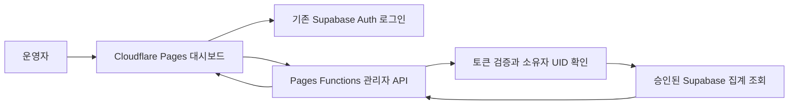

# Blabee 홍보 대시보드 기획서

- 작성일: 2026-10-17
- 상태: 접속 분석 개편 운영 배포·Cloudflare 실제 연결 완료. 실제 관리자 화면의 조회수·Visits·시간대·국가·브라우저·OS와 Supabase 조회 확인
- 사용자: Reddit, X, YouTube, Instagram에서 Blabee를 홍보하는 운영자. 현재 요청한 관리자 계정 세 개만 허용

Blabee 홍보글을 올린 시점과 랜딩 조회·신규 베타 신청의 흐름을 함께 보고, 다음에 어떤 채널과 콘텐츠에 시간을 쓸지 결정하는 개인용 대시보드다. Cloudflare에 화면과 서버 API를 호스팅하고, 기존 Supabase의 집계 데이터를 조회한다.

2026-10-17 후속 요청은 [접속 분석 개편 명세](ANALYTICS.md)를 따른다. 게시물 관리·홍보 성과 소개 영역을 화면에서 제거하고, 정확한 `/blabee`·`/blabee/`의 Cloudflare 페이지 조회수·Visits·시간 추이·시간대·국가·브라우저·OS를 추가했다. Supabase의 유입 경로·신규 베타 신청은 원천 범위를 구분해 유지한다. 아래 게시물 중심 기획은 최초 버전의 기록이며 현재 UI 요구사항을 대체하지 않는다. 배포·검증·연결 한계는 [연결 기록](CONNECTION.md)에 남긴다.

첫 버전의 핵심은 **랜딩 조회수, 신규 베타 신청 수, 날짜별 추이, 게시물 기록**이다. 게시물별 성과는 다른 세션에서 제공하는 식별 결과가 있을 때 연결한다. UTM 링크 생성·수집·귀속 규칙은 이 작업에서 변경하지 않는다.

## 목표와 사용 흐름

| 확인하려는 질문 | 화면에서 제공할 답 |
|---|---|
| 최근 홍보 이후 관심과 신청이 늘었는가 | 기간별 조회·신청 추이와 게시 시점 표시 |
| 어떤 채널에서 신규 신청이 발생했는가 | 채널별 조회수·신규 신청 수와 출처 상태 |
| 어떤 게시물을 다시 만들거나 후속으로 올릴까 | 게시물 목록, 원문, 게시 시각, 연결 가능한 성과 |
| 오늘 보이는 숫자를 믿어도 되는가 | 집계 기준, 데이터 조회 시각, 미수집·부분 집계 표시 |

기본 흐름은 로그인 → 최근 7일 확인 → 그래프에서 변동 구간 선택 → 해당 날짜의 게시물과 채널 확인 → 게시물 상세 확인이다. 운영 화면은 한국어를 기본으로 제안한다. 공개 랜딩페이지의 영문 콘텐츠와는 별도다.

## 작업 범위와 소유권

| 구분 | 이번 대시보드의 책임 | 다른 작업의 책임 |
|---|---|---|
| 화면 | 필터, 카드, 그래프, 날짜·채널·게시물 목록, 상태 표시 | 공개 랜딩페이지 디자인 |
| 데이터 | 승인된 집계 조회 API와 화면용 응답 변환 | UTM 수집 코드, 기존 저장 구조와 귀속 규칙 |
| 게시물 | 제목·원문·게시 시각·채널·메모와 외부 식별자의 연결 기록 | 추적 URL 생성, UTM 값 생성·정규화 |
| 접근 | 소유자 인증·권한 검사, 집계 결과만 전달 | 제품 사용자에게 관리자 권한 부여 |
| 배포 | 기존 Pages 프로젝트에 관리자 경로·Functions를 통합해 승인 후 배포 | UTM 수집 규칙과 공개 랜딩 변경 |

UTM 세션의 `TRACKING.md`, 마이그레이션, 집계 SQL, 랜딩 JS, 신청 폼, 테스트, `_headers`는 읽기 전용 참고 대상이다. 대시보드에 필요한 새로운 조회 권한·RPC가 있다면 기존 UTM 객체를 수정하지 않는 별도 후속 작업으로 범위를 정한다. 이 기획 단계에서는 DB·인증 설정·환경 파일을 변경하지 않는다.

첫 버전에서 제외할 기능은 SNS 자동 게시, SNS API 자동 연동, 추적 링크 생성, 광고비·ROI, 알림·보고서 자동 발송, 고유 방문자 추적, 사람별 행동 기록, 과거 게시물 귀속 복원이다. 데모 재생·CTA 클릭·체류 시간·앱 활성화 분석은 별도 계측이 준비된 이후 검토한다.

## 지표 정의와 제공 조건

### 첫 버전 지표

| 지표 | 정의와 집계 | 화면 표현 |
|---|---|---|
| 랜딩 조회수 | 선택한 범위에서 기록된 페이지 로드 수의 합. 새로고침도 포함 | `조회수`로 표시하고 사람·세션 수로 이름을 바꾸지 않음 |
| 신규 베타 신청 수 | 원본 시스템이 새로 저장한 신청 수. 기존 기준은 정규화 이메일의 최초 한 건 | 동일 이메일의 재신청은 증가시키지 않음 |
| 채널별 조회·신청 | 공급자가 제공한 출처 구분에 따른 합계 | Reddit·X·YouTube·Instagram 외의 출처도 보존 |
| 신청 출처 확인 비율 | 전체 신규 신청 중 UTM 또는 외부 리퍼러로 출처를 확인한 신청의 비중 | 보조 상태로 표시. 유입 전체의 추적 성공률로 해석하지 않음 |

상단 주요 카드는 조회수와 신규 신청 두 개로 시작한다. 같은 면적을 채우기 위해 전환율이나 추정 방문자 수를 만들지 않는다. 출처 확인 비율과 수집 상태는 카드 아래의 짧은 상태 영역에서 확인한다.

### 데이터가 준비되면 추가할 지표

| 지표 | 활성화 조건 |
|---|---|
| 신청 전환율 | 동일한 범위·귀속 규칙으로 추적한 방문 세션과 신규 신청이 연결되어야 함. 분자는 신규 신청이 발생한 세션, 분모는 추적 가능한 대상 방문 세션 |
| 시간대별 유입 | 방문 원시 시각 또는 시간 단위 집계가 제공되어야 함 |
| 게시물별 조회·신청 | 외부 식별자와 게시물 사이의 명시적 연결이 있어야 함 |
| 게시 후 첫 24시간·7일 성과 | 게시 시각부터 정확한 관측 구간을 계산할 수 있는 데이터와 충분한 수집 범위가 있어야 함 |
| 실제 앱 사용으로의 연결 | 계정·설치·활성 사용의 별도 정의와 승인된 연결 데이터가 있어야 함 |

같은 기간의 신청 수를 조회수로 나눈 값은 방문 세션 전환율이 아니다. 첫 버전에서는 이 비율을 주요 카드나 게시물 순위에 사용하지 않는다. Cloudflare의 `Visits`도 대시보드에서 정의한 방문 세션과 자동으로 같다고 취급하지 않는다.

출처 상태는 다음처럼 구분한다.

- `UTM 확인`: 제공된 태그로 출처를 식별한 기록.
- `리퍼러 확인`: 외부 사이트 호스트로 출처를 식별한 기록.
- `직접 또는 출처 불명`: 측정은 했지만 출처를 확인하지 못한 기록. 직접 입력으로 단정하지 않는다.
- `출처 미측정`: 과거·기존 클라이언트·측정 거부 등으로 출처 데이터가 없는 신청.

### 대상 페이지 범위

목표 범위는 `biadone.com/blabee` 랜딩이다. 회사 메인 `/`의 트래픽은 포함하지 않는다. Cloudflare 경로 데이터가 있으면 `/blabee`와 `/blabee/`를 합쳐 보고 정책·에셋 요청은 제외한다.

현재 로컬 UTM 초안의 조회 카운터에는 경로 필드가 없고, 기본 랜딩과 `/blabee/liquid-glass/light/`가 같은 수집 경로를 사용한다. 이 데이터는 `Blabee 랜딩 합산`으로 표시한다. 별도 경로 구분이 제공되기 전에는 기본 랜딩만의 수치라고 표시하거나 호환 경로의 조회를 임의로 빼지 않는다.

## 화면 구성

```text
Blabee 홍보 성과                         데이터 조회 시각 · 계정

[최근 7일 / 30일 / 직접 선택] [채널] [캠페인] [집계 기준]

[랜딩 조회수]                [신규 베타 신청]
대상 범위 · 집계 시간대 · 출처 확인 상태 · 부분 집계 안내

조회수 추이                 게시 시점 표시
신규 신청 추이              같은 시간축

[날짜별] [채널별] [게시물별]             최신순 / 정렬
목록 및 선택한 행의 상세
```

### 기간과 필터

- 기본 기간은 원천 집계 시간대 기준 최근 7개 달력 날짜이며 오늘을 포함한다. 30일과 직접 선택을 제공한다.
- 기본 원천이 UTC 일별 데이터라면 `최근 7일 · UTC 기준`을 명시한다. 정확한 최근 168시간이라는 의미로 사용하지 않는다.
- 최근 24시간·시간별 보기는 해당 지표의 시간 단위 데이터가 있을 때만 활성화한다. 미지원 이유를 확인할 수 있어야 한다.
- 채널·캠페인 필터는 카드·그래프·성과 표에 동일하게 적용한다. 게시물 기록의 채널 필터만 적용되는 경우는 범위를 별도로 표시한다.
- 지원하지 않는 세분화로 전체 값을 반복 표시하지 않는다. 채널 구분이 없는 신청 수는 해당 필터에서 `채널별 집계 미제공`으로 남긴다.
- 기간의 내부 경계는 시작 포함·종료 제외로 통일한다. 오늘은 `집계 중`으로 표시한다.

### 주요 카드와 시간 그래프

조회수와 신규 신청 수는 독립된 카드로 표시한다. 집계 대상, 단위, 출처를 도움말에서 확인할 수 있다. 완료된 이전 동일 길이 기간과 정의·시간대·대상 범위가 같을 때만 증감률을 제공한다. 오늘이 포함되어 비교 완료 상태가 다른 경우 기본 증감률은 숨긴다. 이전 값이 0이면 무한대 퍼센트 대신 건수 차이를 표시한다.

조회수와 신청 수는 같은 시간축의 그래프 두 개를 위아래로 둔다. 규모 차이가 큰 값을 이중 축 하나에 겹치지 않는다. 날짜 선택은 두 그래프와 하단 날짜 행에 함께 반영한다. 게시 마커를 선택하면 채널, 제목, 정확한 게시 시각, 원문 링크를 보여준다.

게시 시점은 참고 정보다. 게시 직후 그래프가 올랐다는 이유만으로 그 게시물에 성과를 귀속하지 않는다. 시간대나 버킷 경계가 다른 두 지표는 동일한 날짜의 퍼널처럼 정렬하지 않는다.

### 날짜별 목록

| 열 | 동작 |
|---|---|
| 날짜 또는 집계 구간 | 기본 최신순. UTC 기준 여부와 집계 중 상태 표시 |
| 조회수 | 그래프의 같은 버킷과 동일한 값 |
| 신규 신청 | 동일 시간대·구간으로 제공 가능한 경우 같은 행에 표시 |
| 게시물 | 해당 집계 구간에 게시된 글의 개수와 제목 |
| 데이터 상태 | 완료·부분·누락·미제공 구분 |

날짜 행을 선택하면 해당 날짜의 채널별 수치와 게시물 목록을 연다. 신청 데이터만 시간별로 제공되는 경우 신청 전용 시간별 보기는 가능하지만, 조회수도 시간별로 측정되었다는 인상을 주지 않는다.

### 채널별 목록

Reddit·X·YouTube·Instagram을 먼저 읽을 수 있게 배치하되, 기타 출처·직접 또는 출처 불명·출처 미측정도 숨기지 않는다. 열은 채널, 조회수, 신규 신청, 선택한 지표의 구성비, 출처 확인 방식이다. 구성비는 조회 또는 신청 중 선택한 한 지표의 합계를 분모로 사용한다. 지원하지 않는 값은 순위 계산에서 제외한다.

새 채널이 생겨도 기존 네 채널 중 하나로 강제 분류하지 않는다. 표시용 이름과 원본 출처는 함께 보존하고, 제공된 연결 정보 없이 리퍼러 호스트를 특정 게시물로 바꾸지 않는다.

### 게시물별 목록과 상세

게시 시각, 채널, 제목, 원문 링크, 콘텐츠 형식, 연결 상태를 기본 열로 둔다. 조회수·신규 신청 열은 게시물별 연결 데이터가 있을 때 제공한다. 기본 정렬은 게시 시각 내림차순이다. 수치 정렬은 비교 가능한 행에만 적용한다.

상세에는 게시 시각, 원문, 채널, 콘텐츠 형식, 메모, 외부 식별자, 연결된 성과와 관측 기간을 둔다. 게시물 기록은 직접 추가·수정할 수 있도록 설계하되, 추적 링크를 만들거나 기존 UTM 값을 수정하는 기능은 포함하지 않는다.

게시물 메타데이터에는 대시보드 내부 ID, 채널, 제목, 게시 시각과 UTC 오프셋, 원문 URL을 필수로 둔다. 콘텐츠 형식·링크 위치·메모·외부 참조 식별자는 선택 사항이다. 저장 방식은 구현 전 확정하며 기존 Supabase에 저장이 필요하면 대시보드 전용 객체로 분리한다. 삭제는 원천 수집 데이터를 지우지 않으며, 사용자에게 결과를 보여준 뒤 확인받는다.

같은 출처·캠페인·콘텐츠 값이라도 여러 게시물이 링크를 공유할 수 있다. 실제로 제공된 복합 식별 기준으로 연결하고, 중복 연결은 `공유 링크` 또는 `연결 불명확`으로 표시한다. 같은 성과를 각 게시물에 복제해 합계를 부풀리지 않는다. 게시물 제목·게시 시각의 유사성으로 자동 매칭하지 않는다.

첫 24시간·7일 보기는 정확한 시각 집계가 제공될 때 추가한다. 관측 기간이 아직 끝나지 않았거나 수집이 중간에 시작된 경우 `관측 중` 또는 `일부 기간`을 표시하고 완전 관측 게시물과 같은 순위로 비교하지 않는다.

## 데이터 상태와 시간 처리

| 상황 | 표시 원칙 |
|---|---|
| 정상 수집 범위의 값이 0 | `0` |
| 수집 여부를 알 수 없거나 아직 연결하지 않음 | `—`와 `연결 대기` 또는 `수집 여부 확인 필요` |
| 지표·차원이 제공되지 않음 | `—`와 `미제공` |
| 일부 버킷이 누락됨 | `부분 집계`. 합계를 표시하면 부분 합계임을 함께 표시 |
| 일반 조회 실패 | 오류와 다시 조회 동작. 권한이 계속 유효한 경우에만 이전 성공 데이터를 조회 시각과 함께 구분 |
| 로그아웃·401·403·계정 변경 | 이전 집계·게시물 데이터를 화면·메모리·클라이언트 캐시에서 지우고 로그인 또는 권한 안내 표시 |
| 샘플링·추정치 | 값 옆에 `추정` 표시, 원천 정보에서 샘플링 수준 확인 |
| 조회 결과가 비어 있음 | 수집 범위를 먼저 확인. 빈 응답만으로 방문 0을 확정하지 않음 |

버킷 누락을 0으로 채우거나 그래프 선으로 가로질러 연결하지 않는다. 공개 글이 없었던 날짜도 데이터의 정상 수집 범위가 확인되면 그대로 표시한다.

UTC 일별 조회수를 한국 날짜로 재명명하지 않는다. 예를 들어 10월 17일 UTC 버킷은 한국 시간 10월 17일 09:00부터 18일 09:00까지다. 화면에서 이 대응 구간을 설명할 수 있지만 한국 시간 자정 기준 일별 조회수로 재집계할 수는 없다. 게시물 시각은 KST로 읽을 수 있게 표시하고 원본 시각도 확인 가능하게 한다.

현재 일별 조회 카운터에는 마지막 개별 방문 시각이 없다. API를 방금 조회했다는 사실과 수집기가 정상이라는 판단은 분리한다. `데이터 조회 시각`, `집계 범위`, 공급자가 확인해 준 경우의 `수집 상태`를 구분한다.

## Cloudflare와 Supabase 구성

### 기본 구조



정적 HTML·CSS·JavaScript와 Cloudflare Pages Functions를 사용한다. 사용자 요청에 따라 기존 Pages `biadone` 프로젝트의 `/blabee/admin/`에 통합한다. `/blabee/관리자`는 정식 관리자 주소로 이동한다. 공개 사이트의 프레임워크는 유지하며 관리자 정적 자산만 해당 하위 경로에 패키징한다. 서버·설정·SQL·문서는 공개 디렉터리 밖에 둔다. Functions는 관리자 경로에만 적용한다.

운영 데이터의 주 원천은 기존 Supabase다. Cloudflare가 호스팅을 맡는다고 해서 Cloudflare Web Analytics의 숫자를 자동으로 가져오는 것은 아니다. Cloudflare RUM을 추가하면 별도 출처로 다루고, Supabase 조회수와 합산하거나 서로 다른 출처로 전환율을 만들지 않는다.

개발 중에는 실제 API와 같은 형태의 명시된 샘플 데이터를 사용한다. 샘플 모드는 항상 화면에 표시한다. 최종 데이터 연결 완료 조건은 Cloudflare의 API가 기존 Supabase에서 승인된 실제 집계를 읽는 것이다. 로컬 파일 가져오기나 샘플 화면 완성을 운영 완료로 보지 않는다.

### 로그인과 접근 권한

기존 Supabase Auth 프로젝트를 재사용한다. 매 집계 요청마다 Pages Functions가 토큰을 Supabase Auth 서버에서 검증한 뒤 설정된 소유자 UID를 우선 비교한다. UID 설정 전에는 사용자가 지정한 `biadone.official@gmail.com`과 서버가 확인한 인증 완료 이메일을 비교한다. DB는 별도로 등록된 소유자 UID를 다시 검사한다. 브라우저가 보낸 사용자 ID나 검증하지 않은 JWT 내용으로 권한을 부여하지 않는다. 로그인에 성공한 일반 제품 사용자는 관리자 API에 접근할 수 없다.

집계 응답에는 이메일·신청 원문·IP·인증 토큰을 넣지 않는다. 인증 실패·만료는 401, 유효한 비소유자 계정은 403으로 구분한다. 로그아웃·401·403·계정 변경 시에는 이전 집계와 게시물 데이터를 즉시 비운다. 인증 상태를 확인할 수 없으면 민감한 수치를 숨기고 집계 조회를 중단한다. 모든 관리자 API는 공통 권한 검사를 거쳐야 한다.

정적 로그인 화면과 빈 UI 코드는 공개될 수 있지만 실제 수치는 보호된 API에서만 내려온다. 정적 화면까지 접근을 막을 필요가 있으면 Cloudflare Access를 추가 검토한다. 커스텀 도메인, 운영 `pages.dev`, 미리보기 호스트에서 API 접근 제한을 동일하게 검증한다. `noindex`와 숨긴 URL은 접근 통제로 사용하지 않는다.

브라우저에는 공개 가능한 Supabase URL·publishable key만 허용한다. 기존 로그인 수단·세션 유지·갱신 방식은 실제 프로젝트 설정을 확인해 재사용한다. 비밀 키와 DB 연결 정보가 필요하면 Cloudflare 서버 바인딩에서만 사용하며, 운영·미리보기 설정을 분리한다. 원천 비밀값을 클라이언트 번들·문서·로그·샘플 파일에 넣지 않는다.

### Supabase 읽기 경계

현재 로컬 측정 계약에는 공개 집계 조회 API가 없다. publishable key가 신청 RPC를 호출할 수 있다는 사실만으로 보고서 조회 권한이 있다고 가정하지 않는다. 서버용 키도 필요한 SQL 권한을 자동으로 제공한다고 가정하지 않는다.

연결 전 기존 조회 수단과 권한을 확인한다. 추가가 필요하면 대시보드 전용 집계 RPC처럼 반환 범위가 제한된 읽기 경로를 제안하고, 별도 마이그레이션·권한 검토 작업으로 다룬다. 원시 신청 테이블을 공개 브라우저에 열거나 UTM 수집 함수를 수정하지 않는다. 조회 범위는 서버에서 고정하고 사용자에게 임의 SQL·테이블·스키마 선택을 허용하지 않는다.

권장 읽기 API는 동일 출처의 `GET /api/admin/overview`와 `GET /api/admin/posts`다. 이름은 구현 전 초안이며 기존 공개 API 계약을 변경하지 않는다. 서버는 날짜 형식, 최대 조회 기간, 지원하는 집계 단위, 채널·캠페인 값을 검증한다. 초기 최대 조회 기간은 90일로 제안하고 데이터의 실제 보존 범위도 함께 표시한다. 인증된 데이터 응답은 `Cache-Control: private, no-store`로 공유 캐시 저장을 막는다.

게시물 등록·수정 API는 실제 저장 위치를 정한 후 별도로 정의한다. 사용자가 제공한 제목·메모는 텍스트로 표시하고, 원문 URL은 HTTP(S)만 허용한다. 쿼리는 매개변수로 제한하고 외부 URL을 서버가 임의로 가져오지 않는다.

## 대시보드 데이터 응답 조건

아래는 화면과 집계 API 사이의 조건이다. UTM 파라미터·저장 스키마·귀속 규칙을 새로 정의하는 계약이 아니다.

| 데이터 | 필요한 내용 |
|---|---|
| 응답 버전 | 화면과 어댑터가 지원하는 데이터 버전 |
| 조회 정보 | 응답 생성 시각, 요청 기간, 원천별 집계 범위·시간대·단위 |
| 대상 범위 | 호스트·경로 또는 랜딩 합산 범위, 포함·제외 조건 |
| 제공 기능 | 가능한 지표, 시간 단위, 채널·캠페인·게시물 구분, 전환율 지원 여부 |
| 지표 | 이름, 단위, 정의, 원천, 값 또는 `null`, 데이터 상태 |
| 시계열 | 버킷 시작·종료 시각, 값 또는 `null`, 완료·부분·누락 상태 |
| 출처별 집계 | 제공된 원본 출처와 표시 이름, 조회수·신규 신청, 분류 상태 |
| 게시물 | 내부 ID, 제목, 채널, 원문, 게시 시각, 외부 참조와 연결 상태 |
| 품질 정보 | 샘플링·추정·누락·수집 시작·부분 관측에 관한 제공 가능한 정보 |

집계가 기간 전체 합계만 제공하면 주요 카드와 출처 표만 표시하고 날짜별 그래프는 `일별 데이터 미제공`으로 남긴다. 총합을 날짜에 균등 분배하거나 임의의 곡선을 만들지 않는다. 서로 다른 집계 수준을 중복 합산하지 않으며, 응답 상태를 검증한 뒤 화면 전체를 일관된 조회 결과로 교체한다.

이 상태는 연결 중간 단계다. 첫 버전의 운영 완료에는 최소 UTC 일별 조회수와 같은 기준으로 집계한 일별 신규 신청 수가 필요하다. 날짜별 원천이 제공되기 전에는 날짜별 추이 기능과 데이터 연결 작업을 의존성 대기로 남긴다.

대시보드가 공급자에게 확인할 최소 항목은 다음과 같다. 이 확인은 별도 세션의 작업 범위를 재정의하지 않는다.

- 현재 적용·검증된 집계 원천과 읽기 방법, 수집 시작·가용 기간.
- 조회수의 대상 페이지 범위, 시간대, 버킷 단위, 빈 구간의 의미.
- 신규 신청의 중복 제외·최초 출처 기준과 미측정 분류.
- 게시물과 연결할 수 있는 명시적 식별 기준과 공유 링크의 처리 범위.

## 현재 코드와 연결 지점

다음 내용은 2026-10-17 작업본 기준이다. UTM 세션의 `92dd6b1`·`97fa6a5` 산출물과 운영 DB의 원천 테이블을 확인했다. 대시보드는 기존 추적 마이그레이션을 재실행하지 않고 별도 SQL 두 개만 적용했다.

| 참고 파일 | 기획에 반영한 사실 |
|---|---|
| [TRACKING.md](../../TRACKING.md) | 조회수와 신규 신청의 정의, 출처 분류, 측정 한계, 공개 보고서 API 부재 |
| [추적 마이그레이션](../../supabase/migrations/202610170001_blabee_landing_attribution.sql) | UTC 일별 조회 카운터, 신청의 선택적 출처 메타데이터. 세션·개별 방문 시각·경로 차원은 없음 |
| [기존 집계 보고서](../../supabase/reports/landing-sources.sql) | 출처별 기간 합계. 날짜를 최종 결과에서 제거하므로 그대로 날짜별 그래프에 사용할 수 없음 |
| [기존 신청 마이그레이션](../../supabase/migrations/202609240001_blabee_beta_requests.sql) | 정규화 이메일 중복 제외와 최초 신청 시각 |
| [Supabase 운영 문서](../../supabase/README.md) | 기존 이메일 신청 기능의 운영 기록과 소유자 조회 경로 |
| [랜딩 진입 코드](../../blabee/js/main.js) | 가시 문서당 조회 시도와 신청 처리의 연결 위치 |
| [배포 스크립트](../../scripts/deploy-cloudflare.sh) | `blabee/` 전체를 공개 배포. `reference/`와 별도 도구 폴더는 현재 허용 목록 밖 |

기존 신청의 `created_at`은 시각을 보존하지만 조회수는 UTC 일별 카운터다. 신청만 시간별로 볼 수 있는 경우에도 방문 유입까지 시간별로 제공된다고 해석하지 않는다. 같은 탭의 출처 캐시는 방문 세션 식별자가 아니다.

계획 문서는 `reference/blabee-dashboard/`에 두고, 구현은 `tools/blabee-dashboard/`에 분리했다. 공개 사이트 배포 스크립트가 별도 임시 패키지의 `public/blabee/admin/`에 허용된 자산 9개만 넣고, Functions·서버·설정은 `public/` 밖에 만든다. 실제 데이터·비밀값·내부 문서는 정적 배포 산출물에 넣지 않는다.

## 구현 순서와 작업 상태

| ID | 작업 | 권장 담당 | 의존성 | 완료 기준 | 상태 |
|---|---|---|---|---|---|
| D01 | 기획과 코드 연결 지점 정리 | planner · code_mapper | 없음 | 화면·지표·범위·수용 기준 작성 | 완료 |
| D02 | 실제 데이터·Auth·읽기 권한 확인 | backend · researcher | UTM 세션 산출물 | 제공 가능한 시간·출처·경로 범위와 소유자 UID 확인 | 완료: 운영 원천·확인된 관리자 UID·Google 로그인 검증 |
| D03 | 화면과 데이터 어댑터 구현 | frontend | D01 | 명시된 샘플로 정상·부분·미제공 화면과 반응형 동작 | 완료 |
| D04 | 소유자 인증과 집계 API 구현 | backend | D02 | 모든 읽기 요청에서 인증·소유자 권한 확인, 집계만 반환 | 완료: 전용 RPC 운영 적용, 실제 관리자 JWT HTTP 200 |
| D05 | 게시물 기록과 명시적 성과 연결 | frontend · backend | D02 · D03 | 기록 저장 방식 확정, 공유·미연결 상태 처리 | 구현·격리 CRUD 검증·전용 DB 적용 완료. 실제 계정 읽기 200, 실제 쓰기 확인은 배포 후 |
| D06 | 실제 Supabase 데이터와 화면 연결 | frontend · backend | D03 · D04 | 로컬 Functions 개발 환경에서 승인된 실제 집계와 UTC 일별 조회·신청 시계열 연결 | 완료: 로컬 관리자 OAuth·실제 API 요청 200·원본과 RPC 집계 일치 |
| D07 | 배포 전 계산·권한·화면 검증 | qa_reviewer | D05 · D06 | 격리 데이터·로컬 브라우저로 아래 수용 기준의 배포 전 항목 충족 | 완료: 최종 Node·SQL 91개, 기존 브라우저 6개·하위 경로 4개 통과 |
| D08 | 배포 준비와 승인 후 배포 | 운영 담당 | D07 | 기존 프로젝트의 관리자 경로·설정 검토 후 명시 승인으로 배포 | 2026-10-17 사용자 승인으로 기존 Pages biadone 운영 배포 완료 |
| D09 | 배포 후 운영 검증 | qa_reviewer · 운영 담당 | D08 | Cloudflare에서 실제 Supabase 시계열 조회, 모든 지원 호스트의 접근 제한과 화면 확인 | 운영 화면·config·익명 접근 제한·홍보 링크·모의 브라우저 4개 확인. 실제 소유자 Google 복귀·조회·게시물 쓰기는 미검증 |

데이터가 없으면 실제처럼 보이는 수치로 대체하지 않는다. D04의 대시보드 전용 SQL 두 개를 적용했고 UTM 수집 객체는 변경하지 않았다. 기획·구현·격리 검증·운영 Supabase의 로컬 실제 조회와 승인된 Cloudflare 업로드를 완료했다. 커밋·푸시는 수행하지 않았다. [실제 연결 기록](CONNECTION.md)에 마이그레이션과 HTTP 검증 근거를 정리했다.

## 검증과 수용 기준

### 계산과 데이터

- 카드·그래프·목록은 같은 필터와 원천 범위를 사용하고, 중복 집계 없이 합계가 일치한다.
- 회사 메인 트래픽이 섞이지 않는다. 기본 랜딩만 구분할 수 없으면 실제 랜딩 합산 범위를 표시한다.
- 조회수·세션·사람·신청을 서로 바꾸어 부르지 않는다. 연결 근거가 없으면 전환율을 계산하지 않는다.
- `0`, 미수집, 미제공, 오류, 부분 합계의 표시가 구분된다. 샘플 수치는 항상 샘플로 식별된다.
- UTC 일별 데이터를 KST 일별로 재분배하지 않는다. 날짜 경계·기간 종료 제외·부분 날짜를 검증한다.
- 부분 기간 증감률, 0 분모, 지원하지 않는 필터, 누락 버킷, 중복 게시물 연결을 검증한다.
- 기간 합계만 제공될 때 일별 그래프를 만들지 않는다. 출처 불명·출처 미측정이 합계에서 사라지지 않는다.
- 운영 완료 시 최소 UTC 일별 조회·신청 추이가 실제 데이터로 제공된다. 미제공 안내만 있는 상태는 날짜별 기능 완료로 처리하지 않는다.

### 인증과 배포

- 미로그인·만료·변조 토큰은 거부되고, 유효한 일반 사용자도 집계에 접근하지 못한다.
- 로그아웃·401·403·계정 변경 이후 이전 소유자의 수치와 게시물 정보가 화면·메모리·클라이언트 캐시에 남지 않는다.
- API 응답·번들·로그·오류 메시지·샘플 파일에 비밀값이나 신청 이메일이 포함되지 않는다.
- 인증 응답은 공유 캐시에 저장되지 않고, 서버가 강제하는 범위를 요청 매개변수로 넓힐 수 없다.
- 커스텀 도메인·운영 `pages.dev`·미리보기 호스트에서 동일한 API 접근 제한을 검증한다. 설정이 없으면 접근을 거부한다.
- 관리자 화면 자산 9개만 공개 패키지에 포함하며 서버·설정·SQL·내부 문서는 정적 자산으로 공개하지 않는다.

### 화면과 사용성

- 1440px·768px·390px 폭에서 기간·핵심 숫자·상태를 읽을 수 있다. 좁은 화면의 표는 중요한 열을 유지하고 행 상세로 보완한다.
- 최신순 정렬, 날짜·게시 마커 선택, 필터 유지, 게시물 원문 이동, 재조회가 동작한다.
- 키보드로 필터·행·상세를 조작할 수 있고 선택 상태·포커스가 명확하다. 그래프의 핵심 값은 표로도 확인한다.
- 로그인·세션 만료·권한 없음·로딩·조회 실패·데이터 연결 대기·부분 집계 화면을 검토한다.

구현 단계에서는 집계·날짜·권한처럼 결과가 틀리면 판단에 영향을 주는 로직을 테스트하고, 브라우저에서 실제 화면과 읽기 흐름을 확인한다. 운영 DB에 테스트 신청·조회수를 삽입하지 않고 격리된 데이터와 모의 응답을 사용한다. 배포 전 검증은 D07에서, 실제 Cloudflare 호스트와 설정 검증은 명시 승인에 따른 배포 후 D09에서 완료한다. 이번 문서 작성만으로 런타임·운영 연결 검증을 통과한 것으로 처리하지 않는다.

## 구현 결정과 운영 연결 전 확인 항목

| 항목 | 현재 제안 또는 확인 조건 |
|---|---|
| 운영 주소와 프로젝트 | 기존 Pages `biadone`, `https://biadone.com/blabee/admin/`. 한글 `/blabee/관리자`는 302 진입 링크 |
| 소유자 로그인 | 기존 `biadone.official@gmail.com`과 추가 요청한 `hyunwoojoo.33@gmail.com`·`hn7742@gmail.com`의 확인된 UID 세 개를 API와 DB에 고정. 기존 계정의 로컬 Google 로그인 완료. 운영 콜백은 사용자가 추가 완료 확인 |
| 집계 읽기 경로 | 사용자 JWT로 실행하는 전용 집계 RPC 운영 적용·실제 요청 200 검증. 원본과 동일 스냅샷 집계 일치 |
| 게시물 저장 | 비공개 `blabee_dashboard` 스키마와 전용 RPC 운영 적용. 실제 읽기 200·격리 CRUD 통과 |
| 시간대별 유입 | 원천이 지원할 때 추가. 현재 UTC 일별 데이터로는 미지원 |
| 게시물별 성과 | 출처 네 필드의 명시적 연결로 구현. 같은 식별 기준을 공유하는 게시물에는 성과를 중복 귀속하지 않음 |
| 서버 의존성 | Pages Functions의 기본 `fetch`와 브라우저 PKCE로 구현. 새 프로덕션 의존성 없음 |

## 구현 결과

구현은 [대시보드 소스와 운영 문서](../../tools/blabee-dashboard/README.md)에 정리했다. 전용 SQL·소유자 등록을 운영 Supabase에 적용했고 로컬 Google 로그인 이후 실제 관리자 JWT의 조회 성공과 집계 대조를 확인했다. 최종 Node·격리 SQL·통합 경로 검사 91개와 로컬 브라우저 시나리오 10개를 완료했다. 승인 후 Cloudflare 운영 배포를 완료하고 운영 브라우저 4개 시나리오와 실제 config·익명 API를 확인했다. 운영 provider 복귀·실제 소유자 조회·게시물 쓰기는 아직 직접 검증하지 않았다. UTM 수집 JavaScript·SQL은 변경하지 않았다.

관리자 하위 경로 대응 후 검사는 Node·SQL 총 86개와 추가 브라우저 4개를 통과했다. 같은 origin의 코드 신뢰 범위를 공유한다는 한계를 기록하고 하위 경로 이탈·새로고침·BFCache 복귀 시 인증·개인 데이터를 정리한다. 기존 UTM 리디렉션은 유지하고 `_redirects`에는 관리자 한글 별칭 두 개만 추가했다.

배포 후 관리자 HTML에는 `no-store, no-transform`을 적용해 Cloudflare 자동 RUM 삽입을 제외했다. workerd가 지원하지 않는 `redirect: error`를 `manual`로 바꾸고 Auth·데이터 원천의 모든 3xx를 거부했다. 관련 회귀 검사와 실제 격리 workerd 대조를 포함해 최종 91개 검사에 통과했다.

이후 두 계정의 관리자 추가 요청에 따라 복수 UID API 설정과 별도 등록 SQL `004`를 적용했다. 기존 관리자와 공개 자산을 보존했고, 추가 권한·실패 시 거부 검사를 포함한 전체 **99개 검사**에 통과했다. 현재 세 계정만 API와 DB에 명시적으로 허용한다. 최신 배포와 검증 경계는 [실제 연결 기록](CONNECTION.md)에 있다.

## 공식 참고 자료

- [Cloudflare Pages Functions](https://developers.cloudflare.com/pages/functions/): 정적 화면과 같은 프로젝트의 서버 API 구성.
- [Pages Functions 바인딩과 비밀값](https://developers.cloudflare.com/pages/functions/bindings/): 서버 설정과 운영·미리보기 환경 분리.
- [Pages Functions 라우팅](https://developers.cloudflare.com/pages/functions/routing/): 관리자 API가 공통 인증 경로를 거치는지 검증.
- [Supabase JWT 검증](https://supabase.com/docs/guides/auth/jwts): 서버에서 유효한 사용자 토큰 확인.
- [Supabase API 키와 권한](https://supabase.com/docs/guides/getting-started/api-keys): 공개용·서버용 키와 SQL 권한의 구분.
- [Supabase RLS](https://supabase.com/docs/guides/database/postgres/row-level-security): 역할·권한·행 접근과 집계 조회 경계.
- [Cloudflare Web Analytics FAQ](https://developers.cloudflare.com/web-analytics/faq/): 샘플링·측정 누락과 UTM·이벤트 지원 범위.
- [Pages 미리보기 접근 제한](https://developers.cloudflare.com/pages/configuration/preview-deployments/): 미리보기 보호가 운영 호스트 보호를 대신하지 않음.
